# LAPORAN PRAKTIKUM PEMROGRAMAN BERBASIS OBJEK

| Informasi Praktikan | Keterangan |
| :--- | :--- |
| **Nama** | Muhammad Farrel Rizky |
| **NPM** | 4525210117 |
| **Kelas** | A |
| **Mata Kuliah** | Pemrograman Berbasis Objek (PBO) |
| **Pertemuan** | Pertemuan 10 - Penanganan Eksepsi Domain dan Refactoring Guard Clause |
| **Tanggal** | 05/11/2026 |

---

## 1. Implementasi Java

### 1.1. File: `PerpustakaanException.java`
**Penjelasan Kode:**
> Kelas abstrak ini berfungsi sebagai induk (*super class*) untuk seluruh eksepsi domain perpustakaan. Diturunkan dari `RuntimeException` (*unchecked exception*) karena eksepsi domain terjadi akibat permintaan pengguna yang tidak sah dan penanganannya dapat terpusat pada lapisan terluar (`App`). Pada berkas akhir (*after*), ditambahkan metode abstrak `getData()` yang mengembalikan `Map<String, Object>` berisi informasi spesifik penyebab kesalahan.

**Bukti Eksekusi (Screenshot):**
- **Before** *(Kondisi awal / Kesalahan kompilasi)*:
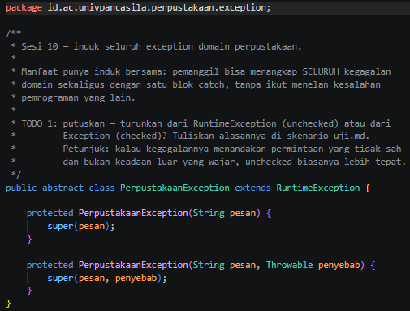

- **After** *(Kondisi akhir / Eksekusi berhasil)*:
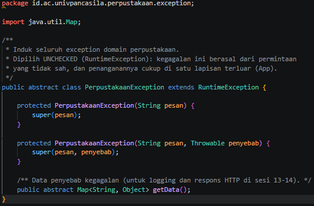

---

### 1.2. File: `BukuTidakDitemukanException.java`
**Penjelasan Kode:**
> Merupakan eksepsi domain spesifik yang dilemparkan saat ISBN buku yang dicari tidak ditemukan pada sistem. Kode *after* menambahkan atribut `isbn` bertipe `final String`, konstruktor berserta pesan informatif, metode pengambil nilai `getIsbn()`, dan implementasi metode `getData()` untuk pengembalian data ISBN.

**Bukti Eksekusi (Screenshot):**
- **Before** *(Kondisi awal / Kesalahan kompilasi)*:
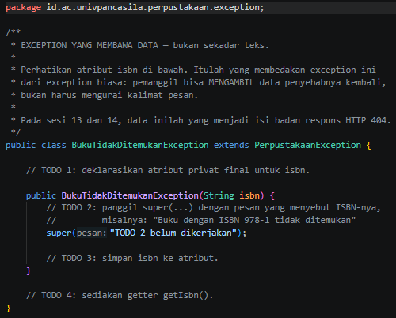

- **After** *(Kondisi akhir / Eksekusi berhasil)*:
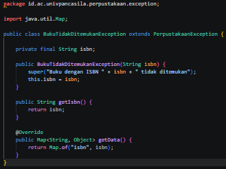

---

### 1.3. File: `AnggotaTidakDitemukanException.java`
**Penjelasan Kode:**
> Subkelas eksepsi untuk menangani kondisi ketika ID anggota tidak terdaftar. Pada kode *after*, kelas ini melengkapi atribut `idAnggota`, konstruktor berserta pesan eksplisit, metode `getIdAnggota()`, serta pemetaan data konteks kesalahan via `getData()`.

**Bukti Eksekusi (Screenshot):**
- **Before** *(Kondisi awal / Kesalahan kompilasi)*:
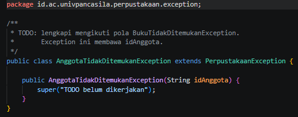

- **After** *(Kondisi akhir / Eksekusi berhasil)*:
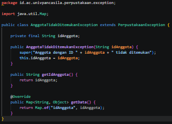

---

### 1.4. File: `BukuSedangDipinjamException.java`
**Penjelasan Kode:**
> Eksepsi domain yang menangani transaksi peminjaman buku saat stok eksemplar habis ($stok \le 0$). Kode *after* menyimpan informasi `isbn` dan `judul` buku, menyediakan metode pengambil nilai (*getter*), serta mengimplementasikan pengembalian data melalui `getData()`.

**Bukti Eksekusi (Screenshot):**
- **Before** *(Kondisi awal / Kesalahan kompilasi)*:
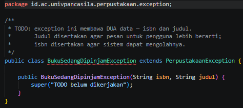

- **After** *(Kondisi akhir / Eksekusi berhasil)*:
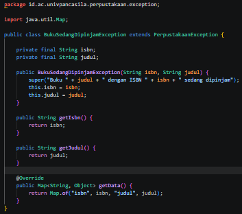

---

### 1.5. File: `BatasPinjamTerlampauiException.java`
**Penjelasan Kode:**
> Eksepsi yang dilemparkan ketika seorang anggota mencoba meminjam buku melebihi kuota maksimum yang diizinkan. Kode *after* menyimpan `idAnggota` dan nilai `batas`, serta mengembalikan data log melalui metode `getData()`.

**Bukti Eksekusi (Screenshot):**
- **Before** *(Kondisi awal / Kesalahan kompilasi)*:
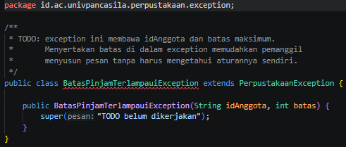

- **After** *(Kondisi akhir / Eksekusi berhasil)*:
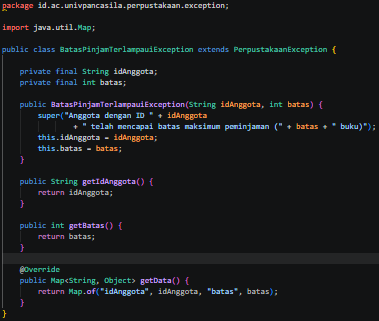

---

### 1.6. File: `LibraryServiceKotor.java`
**Penjelasan Kode:**
> Berkas acuan (*code smell*) yang memiliki struktur penulisan pengondisian bersarang (*nested if-else*) hingga 4 tingkat kedalaman pada metode `pinjam()`. Struktur ini menyulitkan pemeliharaan kode dan mengembalikan nilai boolean `false` tanpa menginformasikan penyebab spesifik kegagalan transaksi.

**Bukti Eksekusi (Screenshot):**
- **After** *(Kondisi akhir / Eksekusi berhasil)*:
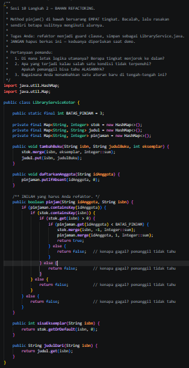

---

### 1.7. File: `LibraryService.java`
**Penjelasan Kode:**
> Berkas hasil refaktor dari `LibraryServiceKotor.java`. Struktur *nested if* digantikan dengan pola *Guard Clause*. Jika prasyarat peminjaman tidak terpenuhi, metode `pinjam()` langsung melempar eksepsi domain yang relevan sehingga logika utama dapat ditulis sejajar (*flat*).

**Bukti Eksekusi (Screenshot):**
- **After** *(Kondisi akhir / Eksekusi berhasil)*:
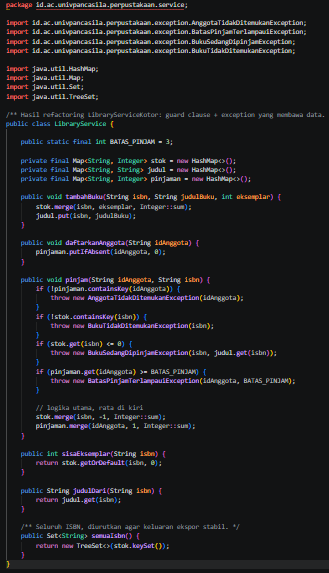

---

### 1.8. File: `EksporService.java`
**Penjelasan Kode:**
> Layanan untuk mengekspor daftar buku ke dalam berkas teks. Berkas ini menggunakan fitur Java *try-with-resources* melalui kelas `PenulisBerkas` guna menjamin penutupan berkas eksternal secara otomatis meskipun terjadi eksepsi di tengah proses penulisan.

**Bukti Eksekusi (Screenshot):**
- **After** *(Kondisi akhir / Eksekusi berhasil)*:
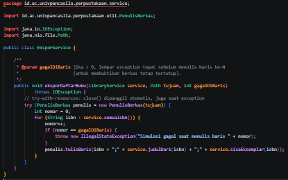

---

### 1.9. File: `CatatanLog.java`
**Penjelasan Kode:**
> Layanan utilitas pencatat log untuk menyimpan jejak eksepsi domain yang terjadi ke dalam berkas `logs/perpustakaan.log`. Berkas mencatat waktu kejadian (*timestamp*), jenis eksepsi, isi peta data penyebab, dan pesan galat.

**Bukti Eksekusi (Screenshot):**
- **After** *(Kondisi akhir / Eksekusi berhasil)*:
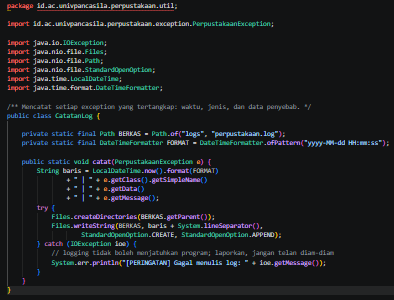

---

### 1.10. File: `PenulisBerkas.java`
**Penjelasan Kode:**
> Pembungkus `BufferedWriter` yang mengimplementasikan antarmuka `AutoCloseable`. Berkas ini bertugas memastikan dan meyakinkan bahwa proses penutupan berkas (*close stream*) dipanggil secara konsisten.

**Bukti Eksekusi (Screenshot):**
- **After** *(Kondisi akhir / Eksekusi berhasil)*:
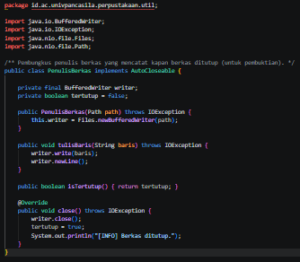

---

### 1.11. File: `App.java`
**Penjelasan Kode:**
> Berkas aplikasi utama berbasis antarmuka baris perintah (CLI). Bertindak sebagai penangkap eksepsi terpusat (*centralized exception handler*). Semua eksepsi domain ditangkap dalam satu blok `catch (PerpustakaanException e)` dan diperiksa tipenya menggunakan fitur *pattern matching for instanceOf*.

**Bukti Eksekusi (Screenshot):**
- **After** *(Kondisi akhir / Eksekusi berhasil)*:
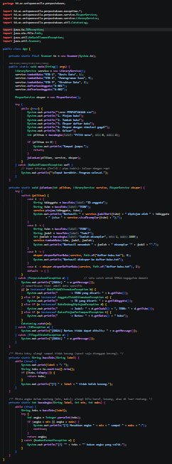

---

### Output
**Output Program:**
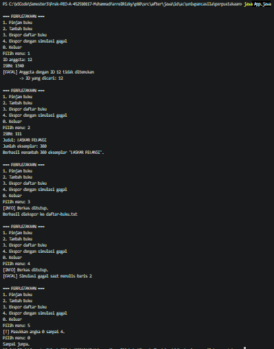

---

## 2. Implementasi PHP

### 2.1. File: `exceptions.php`
**Penjelasan Kode:**
> Berkas pendefinisian hierarki eksepsi domain perpustakaan pada PHP. Menggunakan fitur *Constructor Property Promotion* dan *Readonly Property* milik PHP 8+ untuk mempermudah inisialisasi properti serta menjaga sifat data tetap *immutable*.

**Bukti Eksekusi (Screenshot):**
- **Before** *(Kondisi awal / Galat logika)*:
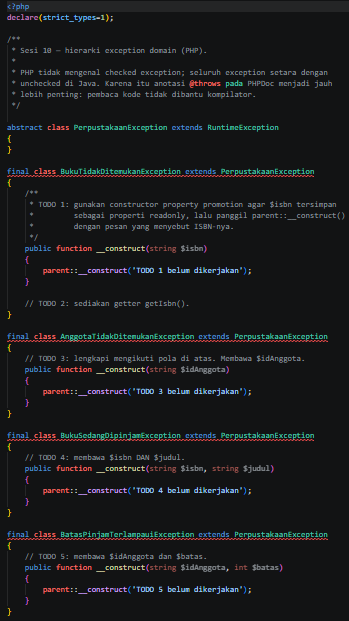

- **After** *(Kondisi akhir / Eksekusi berhasil)*:
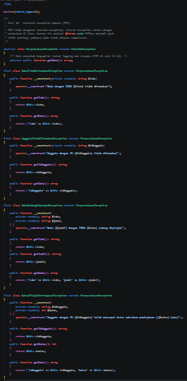

---

### 2.2. File: `LibraryServiceKotor.php`
**Penjelasan Kode:**
> Berkas acuan *code smell* versi PHP yang mendemonstrasikan kelemahan penggunaan pengondisian bersarang (*nested if-else*). Metode `pinjam()` hanya mengembalikan nilai `false` tanpa memberikan konteks alasan kegagalan.

**Bukti Eksekusi (Screenshot):**
- **After** *(Kondisi akhir / Eksekusi berhasil)*:
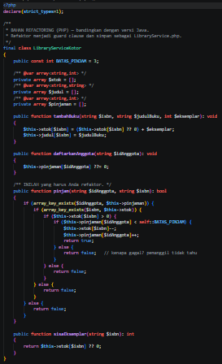

---

### 2.3. File: `LibraryService.php`
**Penjelasan Kode:**
> Hasil refaktor dari `LibraryServiceKotor.php` menggunakan pendekatan *Guard Clause*. Metode `pinjam()` memeriksa prasyarat transaksi di awal dan melempar eksepsi spesifik (`throw new ...`) jika terdapat kondisi tidak sah.

**Bukti Eksekusi (Screenshot):**
- **After** *(Kondisi akhir / Eksekusi berhasil)*:
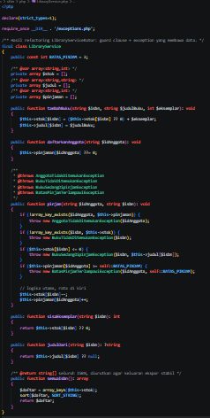

---

### 2.4. File: `EksporService.php`
**Penjelasan Kode:**
> Layanan ekspor daftar buku versi PHP. Karena PHP tidak memiliki fitur *try-with-resources*, proses penutupan berkas (`fclose`) dilakukan pada blok `finally` untuk menjamin berkas fisik selalu tertutup meskipun terjadi gangguan eksekusi.

**Bukti Eksekusi (Screenshot):**
- **After** *(Kondisi akhir / Eksekusi berhasil)*:
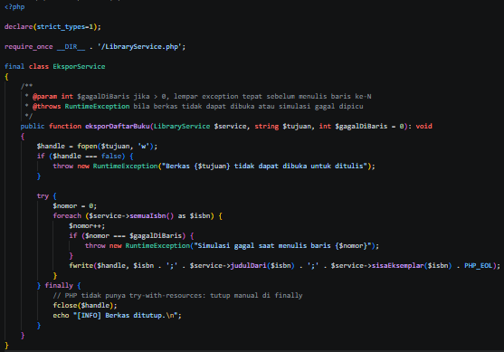

---

### 2.5. File: `CatatanLog.php`
**Penjelasan Kode:**
> Utilitas PHP untuk membuat folder log serta menuliskan entri riwayat kegagalan sistem ke berkas `logs/perpustakaan.log` dalam format string dan JSON.

**Bukti Eksekusi (Screenshot):**
- **After** *(Kondisi akhir / Eksekusi berhasil)*:
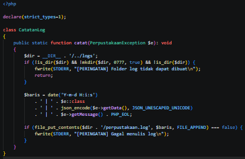

---

### 2.6. File: `app.php`
**Penjelasan Kode:**
> Berkas titik masuk utama (*main entry*) aplikasi PHP berbasis CLI. Membaca masukan pengguna, memproses menu perpustakaan, dan menangani eksepsi domain serta sistem secara terpusat.

**Bukti Eksekusi (Screenshot):**
- **After** *(Kondisi akhir / Eksekusi berhasil)*:
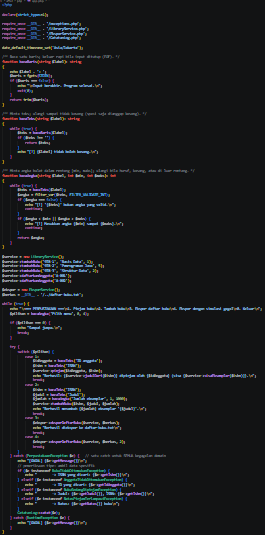

---

### Output
**Output Program:**
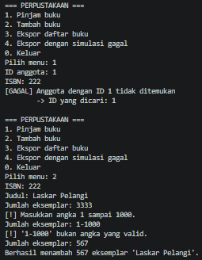

---

## 3. Skenario Pengujian

### 3.1. Skenario Pengujian (Before / Kondisi Awal)

| No | Masukan / Tindakan | Kegagalan yang Diharapkan | Jenis Exception | Pesan yang Ditampilkan |
|---|---|---|---|---|
| 1 | Pinjam ISBN yang tidak terdaftar | Buku tidak ditemukan | BukuTidakDitemukanException | |
| 2 | | | | |
| 3 | | | | |
| 4 | | | | |
| 5 | | | | |
| 6 | | | | |
| 7 | | | | |
| 8 | | | | |
| 9 | | | | |
| 10 | | | | |

---

### 3.2. Skenario Pengujian (After / Kondisi Akhir)

| No | Masukan / Tindakan | Kegagalan yang Diharapkan | Jenis Exception | Pesan yang Ditampilkan |
|---|---|---|---|---|
| 1 | Pinjam: ID `A-001`, ISBN `978-9` | Buku tidak ditemukan | `BukuTidakDitemukanException` | Buku dengan ISBN 978-9 tidak ditemukan |
| 2 | Pinjam: ID `A-009`, ISBN `978-1` | Anggota tidak terdaftar | `AnggotaTidakDitemukanException` | Anggota dengan ID A-009 tidak ditemukan |
| 3 | `A-001` pinjam `978-1`, lalu `A-002` pinjam `978-1` | Eksemplar habis | `BukuSedangDipinjamException` | Buku Basis Data dengan ISBN 978-1 sedang dipinjam |
| 4 | `A-001` pinjam `978-2` tiga kali, lalu pinjam `978-3` | Batas 3 buku tercapai | `BatasPinjamTerlampauiException` | Anggota dengan ID A-001 telah mencapai batas maksimum peminjaman (3 buku) |
| 5 | Pinjam: ID `A-009` dan ISBN `978-9` (keduanya salah) | Anggota diperiksa lebih dulu | `AnggotaTidakDitemukanException` | Anggota dengan ID A-009 tidak ditemukan |
| 6 | Menu: `abc` | Huruf saat diminta angka | `NumberFormatException` (ditangani di `bacaAngka`) | 'abc' bukan angka yang valid. |
| 7 | Menu: (Enter kosong) | Masukan kosong | Tidak ada (guard di `bacaTeks`) | Pilih menu tidak boleh kosong. |
| 8 | Menu: (hanya spasi) | Spasi saja dianggap kosong | Tidak ada (`trim` + guard) | Pilih menu tidak boleh kosong. |
| 9 | Menu: `9` | Angka di luar rentang menu | Tidak ada (guard rentang) | Masukkan angka 0 sampai 4. |
| 10 | Tambah buku, jumlah: `-3` | Angka negatif | Tidak ada (guard rentang) | Masukkan angka 1 sampai 1000. |
| 11 | Tambah buku, jumlah: `99999` | Angka terlalu besar | Tidak ada (guard rentang) | Masukkan angka 1 sampai 1000. |
| 12 | Tambah buku, jumlah: `x` | Huruf saat diminta angka | `NumberFormatException` | 'x' bukan angka yang valid. |
| 13 | Ekspor dengan simulasi gagal (menu 4) | Gagal di tengah penulisan | `IllegalStateException` (Java) / `RuntimeException` (PHP) | `[INFO] Berkas ditutup.` lalu `Simulasi gagal saat menulis baris 2` |
| 14 | Tekan Ctrl+D saat diminta menu | Input ditutup | `NoSuchElementException` (Java) / `fgets false` (PHP) | Input berakhir. Program selesai. |

#### Jawaban Pertanyaan Analisis:
1. **Kesalahan Pengguna vs Pemrogram:** Skenario 1–5 adalah kesalahan pengguna atau keadaan data yang wajar terjadi, sehingga dibuat eksepsi domain yang membawa data agar bisa dilaporkan secara rinci. Skenario 6–12 juga kesalahan pengguna, tetapi ditangani lebih awal di lapisan masukan (guard dan loop ulang) sehingga tidak sampai ke lapisan *service*. Kesalahan pemrogram (seperti `NullPointerException` atau indeks salah) sengaja tidak ditangkap `catch (PerpustakaanException)` agar kesalahan logika (*bug*) dapat langsung terdeteksi.
2. **RuntimeException vs Exception (Checked):** Dipilih `RuntimeException` (*unchecked*). Alasannya: kegagalan ini berasal dari permintaan tidak sah pada lapisan masukan pengguna. Pemanggil di tengah rantai tidak dapat melakukan pemulihan otomatis, sehingga cukup ditangani terpusat pada lapisan terluar (`App`). Jika dibuat *checked*, setiap metode di antara `pinjam()` dan `App` wajib menambahkan penanda `throws`.
3. **Pengalaman Catch Kosong:** Membuat blok `catch` kosong menyebabkan eksepsi tertelan secara diam-diam (*swallowed exception*). Program dapat terus berjalan dalam kondisi data tidak valid tanpa mencetak pesan kesalahan atau log, sehingga sangat menyulitkan proses pelacakan galat (*debugging*).

---

## 4. Kesimpulan

> 1. **Penerapan Exception Domain:** Penggunaan eksepsi domain spesifik menggantikan pengembalian nilai boolean `false` terbukti memberikan konteks kesalahan yang kaya bagi pemanggil, termasuk data penyebab seperti ISBN atau ID Anggota.
> 
> 2. **Pola Guard Clause:** Teknik *Guard Clause* berhasil mengeliminasi struktur *nested if-else*, meningkatkan keterbacaan kode (*code readability*), serta memfasilitasi penambahan aturan bisnis baru secara modular.
> 
> 3. **Pengelolaan Resource:** Penggunaan *try-with-resources* pada Java dan blok `finally` pada PHP menjamin bahwa berkas fisik ditutup dengan aman meskipun alur program terinterupsi oleh eksepsi.