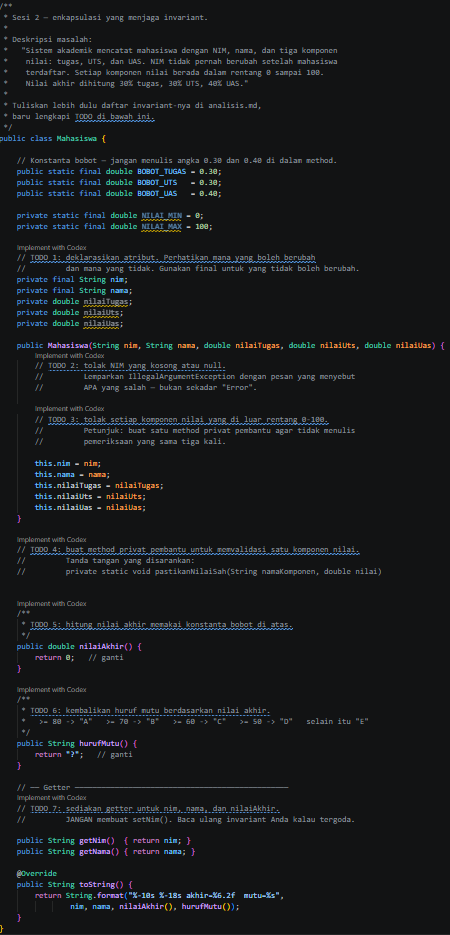
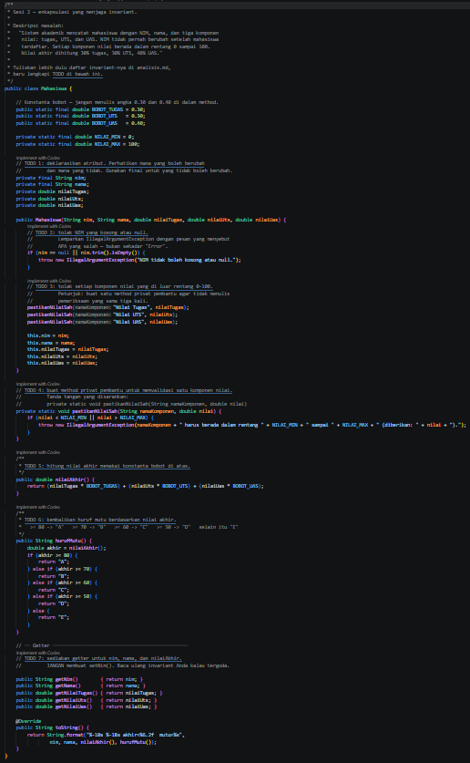
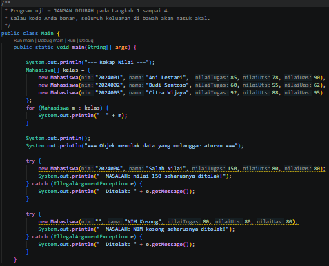
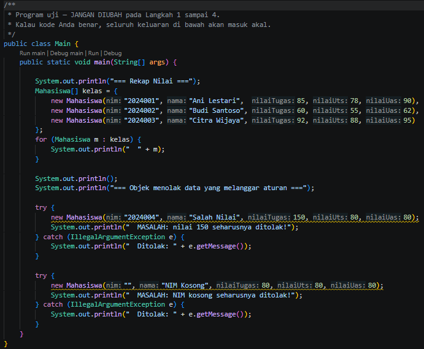
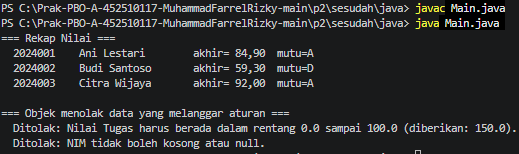
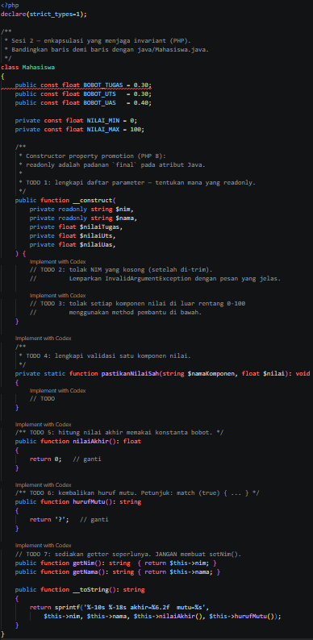
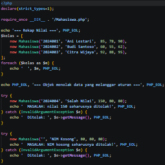
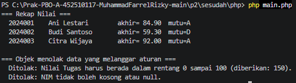

# LAPORAN PRAKTIKUM PEMROGRAMAN BERBASIS OBJEK

| Informasi Praktikan | Keterangan |
| :--- | :--- |
| *Nama* | Muhammad Farrel Rizky |
| *NPM* | 4525210117 |
| *Kelas* | Prak. PBO A Room AI |
| *Mata Kuliah* | Pemrograman Berbasis Objek (PBO) |
| *Pertemuan* | Pertemuan 02 - Kelas, Objek, dan Enkapsulasi |
| *Tanggal* | 10/09/2026 |

---

## 1. Implementasi Java

### 1.1. File: Mahasiswa.java
*Penjelasan Kode:*
> Kelas `Mahasiswa` menerapkan prinsip **Enkapsulasi** dan pemeliharaan **Invariant** (aturan yang harus selalu benar sepanjang siklus hidup objek). Atribut `nim` dan `nama` dideklarasikan dengan kata kunci `final` agar bersifat *immutable* setelah diinisialisasi, sementara atribut nilai (`nilaiTugas`, `nilaiUts`, `nilaiUas`) bersifat `private`. Validasi ketat diterapkan di dalam *constructor* untuk menolak NIM kosong atau nilai di luar rentang $0 \le \text{nilai} \le 100$ menggunakan eksepsi `IllegalArgumentException`. Perhitungan nilai akhir menggunakan bobot terstruktur serta konversi predikat huruf mutu dikemas secara aman di dalam kelas ini.

*Bukti Eksekusi (Screenshot):*
- *Before* (Kondisi awal / Kesalahan kompilasi atau kode belum lengkap):

- *After* (Kondisi akhir / Eksekusi berhasil):

### 1.2. File: Main.java
*Penjelasan Kode:*
> Kelas `Main` berfungsi sebagai titik masuk eksekusi (*entry point*) utama pada program Java untuk menguji instansiasi objek `Mahasiswa`, pengujian penanganan validasi data yang tidak sah, serta menampilkan hasil perhitungan nilai akhir beserta huruf mutu ke konsol.

*Bukti Eksekusi (Screenshot):*
- *Before* (Kondisi awal / Kesalahan kompilasi atau uji coba awal):

- *After* (Kondisi akhir / Eksekusi berhasil):

### Output
*Output Program Java:*

---

## 2. Implementasi PHP

### 2.1. File: Mahasiswa.php
*Penjelasan Kode:*
> Kelas `Mahasiswa` pada PHP mengadopsi standar modern PHP 8.4+ dengan memanfaatkan fitur *Constructor Property Promotion* dan kata kunci `private readonly` untuk menjaga sifat *immutable* pada atribut `nim` dan `nama`. Penggunaan `declare(strict_types=1);` memastikan pemeriksaan tipe data dilakukan secara ketat. Validasi data serta ekspresi `match (true)` diterapkan untuk penentuan huruf mutu secara bersih dan ekspresif.

*Bukti Eksekusi (Screenshot):*
- *Before* (Kondisi awal / Galat logika atau kerangka awal):

### 2.2. File: main.php
*Penjelasan Kode:*
> Berkas `main.php` bertindak sebagai *driver script* untuk menguji perilaku kelas `Mahasiswa` versi PHP, memastikan mekanisme enkapsulasi, validasi parameter, dan kalkulasi akademik berjalan sesuai spesifikasi rancangan.

*Bukti Eksekusi (Screenshot):*
- *Before* (Kondisi awal / Galat logika):

### Output
*Output Program PHP:*

---

## 3. Kesimpulan
> Praktikum Pertemuan 02 ini berhasil membuktikan pentingnya penerapan prinsip **Enkapsulasi** dan pengelolaan **Invariant** secara mandiri di dalam kelas (*constructor* serta *method* internal). Dengan menyembunyikan data di balik tingkat akses `private` / `readonly` / `final` serta menyematkan validasi di dalam objek itu sendiri, program mampu menolak data yang tidak sah (seperti nilai di luar rentang 0–100 atau NIM kosong) sejak tahap *runtime* pertama kali objek diciptakan. Hal ini memastikan integritas data tetap terjaga secara konsisten, baik pada implementasi bahasa **Java** maupun **PHP**.