# LAPORAN PRAKTIKUM PEMROGRAMAN BERBASIS OBJEK

| Informasi Praktikan | Keterangan |
| :--- | :--- |
| *Nama* | Muhammad Farrel Rizky |
| *NPM* | 4525210117 |
| *Kelas* | A |
| *Mata Kuliah* | Pemrograman Berbasis Objek (PBO) |
| *Pertemuan* | Pertemuan 03 - Constructor, Anggota Statis, dan Konstanta |
| *Tanggal* | 17/09/2026 |

---

## 1. Implementasi Java

### 1.1. File: RekeningBank.java
*Penjelasan Kode:*
> Kelas `RekeningBank` menerapkan pengelolaan siklus hidup objek melalui **Constructor Overloading** dan **Delegasi Constructor** (`this(...)`). Konstanta global (`BUNGA_TAHUNAN`, `BIAYA_ADMIN`, `BATAS_PENARIKAN`) didefinisikan menggunakan `public static final` untuk menghindari *magic numbers*. Selain itu, atribut statis `jumlahRekening` digunakan untuk melacak total instansiasi objek secara terpusat, lengkap dengan validasi transaksi (`setor`, `tarik`) serta aturan pemotongan biaya admin.

*Bukti Eksekusi (Screenshot):*
- *Before* (Kondisi awal / Kesalahan kompilasi atau kode belum lengkap):
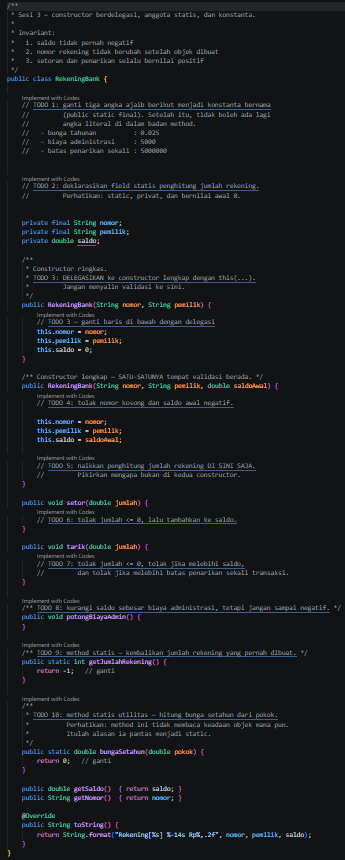

- *After* (Kondisi akhir / Eksekusi berhasil):
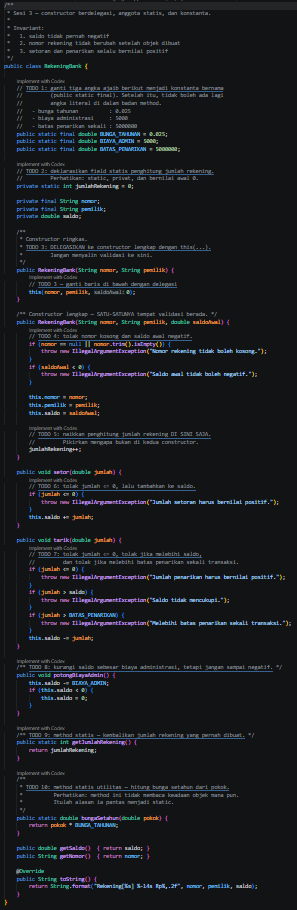

### 1.2. File: Main.java
*Penjelasan Kode:*
> Kelas `Main` bertindak sebagai titik masuk (*entry point*) utama untuk menguji instansiasi objek `RekeningBank` dengan berbagai variasi *constructor*, pengujian validasi transaksi penyetoran dan penarikan, serta pemanggilan *method* statis seperti `getJumlahRekening()` dan `bungaSetahun()`.

*Bukti Eksekusi (Screenshot):*
- *Before* (Kondisi awal / Pengujian awal):
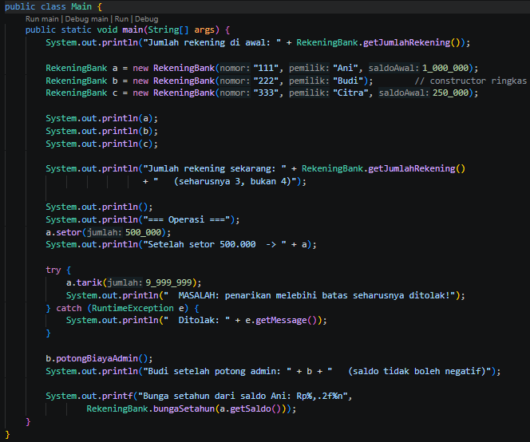

- *After* (Kondisi akhir / Eksekusi berhasil):
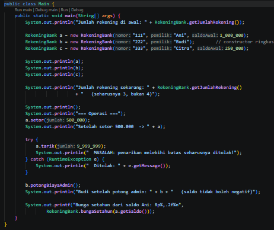

### Output
*Output Program Java:*
- *Sebelum Perbaikan:*
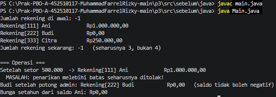
- *Sesudah Perbaikan:*
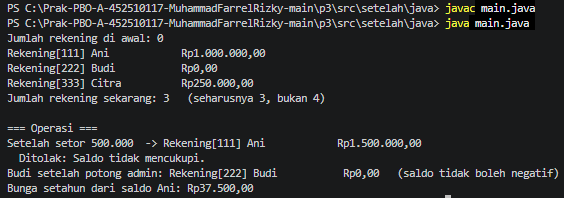

---

## 2. Implementasi PHP

### 2.1. File: RekeningBank.php
*Penjelasan Kode:*
> Kelas `RekeningBank` pada PHP diimplementasikan dengan memanfaatkan fitur modern PHP 8.4+. Karena PHP tidak mendukung *constructor overloading* secara langsung, digunakan *default parameter* pada *constructor* utama. Konstanta kelas didefinisikan menggunakan kata kunci `public const`, serta dilengkapi *static factory method* (`rekeningPelajar()`) dan mekanisme penanganan eksepsi yang ketat.

*Bukti Eksekusi (Screenshot):*
- *Before* (Kondisi awal / Kerangka awal atau galat logika):
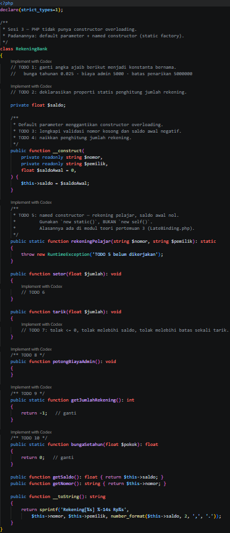

- *After* (Kondisi akhir / Eksekusi berhasil):
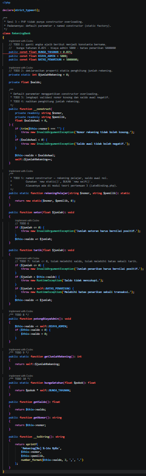

### 2.2. File: main.php
*Penjelasan Kode:*
> Berkas `main.php` berfungsi sebagai *driver script* untuk menguji perilaku kelas `RekeningBank` versi PHP, memastikan fungsionalitas pembuatan rekening, simulasi setor/tarik saldo, dan pemanggilan method statis berjalan dengan benar.

*Bukti Eksekusi (Screenshot):*
- *Before* (Kondisi awal / Pengujian awal):
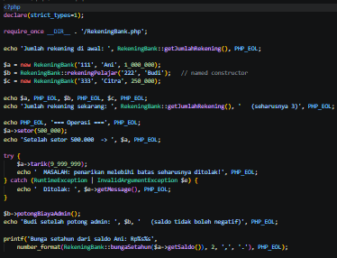

- *After* (Kondisi akhir / Eksekusi berhasil):
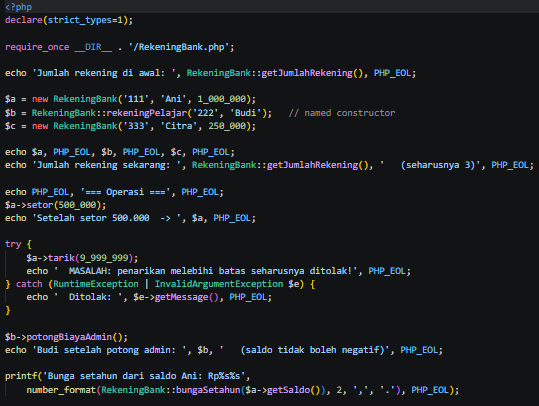

### Output
*Output Program PHP:*
- *Sebelum Perbaikan:*
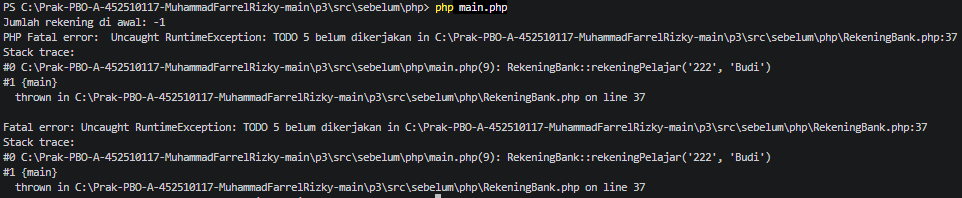
- *Sesudah Perbaikan:*
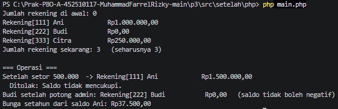

---

## 3. Kesimpulan
> Praktikum Pertemuan 03 ini berhasil membuktikan pentingnya pemahaman siklus hidup objek, penerapan **delegasi constructor** untuk mencegah duplikasi kode validasi, serta pemanfaatan **anggota statis** (`static`) guna mengelola data lintas objek secara terpusat. Penggunaan **konstanta** juga efektif membersihkan kode dari ketergantungan pada angka ajaib (*magic numbers*), sehingga aturan bisnis (seperti batas penarikan, suku bunga, dan biaya admin) menjadi lebih mudah dipelihara pada bahasa Java maupun PHP.