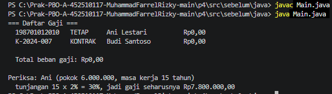
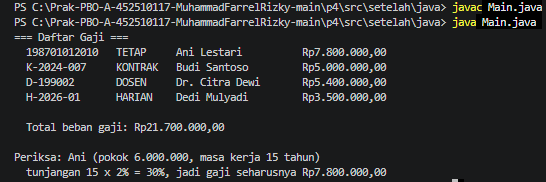
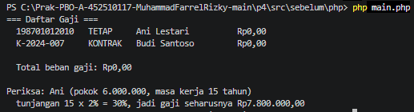
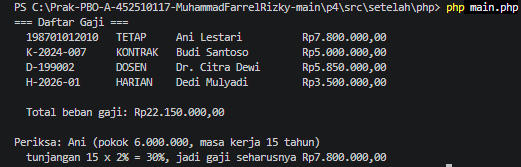

# Praktikum 04 — Pewarisan (Inheritance)

- **Nama:** Muhammad Farrel Rizky
- **NPM:** 4525210117
- **Kelas:** Prak. PBO A Room AI
- **Dosen Pengampu:** Adi Wahyu Pribadi, S.Si., M.Kom

---

## A. Ringkasan Tugas
Praktikum sesi ini berfokus pada penerapan konsep **Pemrograman Berorientasi Objek (PBO)** yaitu **Pewarisan (*Inheritance*)** dan **Polimorfisme**. Kita membangun sebuah hierarki kelas pegawai yang mencakup kelas induk abstrak (`Pegawai`) serta berbagai kelas turunannya (`PegawaiTetap`, `PegawaiKontrak`, `Dosen`, dan `PegawaiHarian`) dalam dua bahasa pemrograman, yaitu **Java** dan **PHP (8.4+)**. Tugas ini menekankan penggunaan kata kunci pewarisan, pemanggilan konstruktor induk (`super` pada Java / `parent::__construct` pada PHP), *method overriding*, serta penambahan kelas baru untuk memperluas fungsi tanpa merusak struktur dasar yang sudah ada.

---

## B. Penjelasan Perubahan & Pengerjaan TODO (Versi Java)

Berikut adalah rincian perubahan dan alasan teknis pada setiap berkas kode dalam versi **Java**:

1. **`Pegawai.java` (Kelas Induk Abstrak)**
   * **TODO 1 (Validasi Gaji Pokok):** Menambahkan pengecekan `if (gajiPokok < 0)` di dalam konstruktor untuk menolak nilai gaji negatif dengan melempar `IllegalArgumentException`. Hal ini menjaga *invariant* objek sejak pertama kali diciptakan.
   * **TODO 2 (Perilaku Dasar `hitungGaji`):** Mengubah implementasi method `hitungGaji()` agar mengembalikan nilai `gajiPokok` apa adanya. Kelas turunan nantinya akan mewarisi atau menimbangnya kembali (*override*).

2. **`PegawaiTetap.java` (Kelas Turunan)**
   * **Struktur Konstruktor:** Memastikan pemanggilan `super(nip, nama, gajiPokok);` berada di baris pertama untuk menginisialisasi atribut dari kelas induk `Pegawai`.
   * **TODO 2 (Perhitungan Gaji):** Mengimplementasikan perhitungan gaji dengan menggabungkan gaji dasar dari induk (`super.hitungGaji()`) ditambah tunjangan masa kerja, yang dihitung berdasarkan persentase per tahun dengan batasan maksimum tertentu (`Math.min`).

3. **`PegawaiKontrak.java`**
   * Kelas ini mewarisi langsung dari `Pegawai`. Karena pegawai kontrak tidak mendapatkan tunjangan khusus masa kerja, method `hitungGaji()` tidak perlu di-override secara eksplisit karena sudah otomatis menggunakan perilaku dasar dari kelas induknya.

4. **Penambahan File Baru pada Java (`Dosen.java` & `PegawaiHarian.java`)**
   * **Alasan Pembuatan File Baru:** Berdasarkan prinsip desain modular di Java, setiap kelas publik (*public class*) wajib ditempatkan di dalam berkas terpisah yang namanya sama persis dengan nama kelas tersebut. Oleh karena itu, untuk memenuhi kebutuhan penambahan jenis pegawai baru (Langkah 4), kita wajib membuat dua file kelas baru:
     * **`Dosen.java`:** Mewarisi kelas `PegawaiTetap` dengan menambahkan atribut spesifik seperti jumlah SKS dan honor per SKS, lalu melakukan *override* pada `hitungGaji()` untuk mengakumulasikan honor akademik ke dalam gaji total.
     * **`PegawaiHarian.java`:** Mewarisi kelas `Pegawai` secara langsung dengan atribut jumlah hari masuk dan upah harian, serta menyesuaikan perhitungan gaji harian.

---

## C. Penjelasan Perubahan & Pengerjaan TODO (Versi PHP)

Penyesuaian pada versi PHP menggunakan pendekatan standar modern PHP 8.4+:
- **Struktur Berkas Tunggal untuk Hierarki:** Sesuai dengan instruksi modul praktikum sesi ini, seluruh kelas hierarki pegawai (`Pegawai`, `PegawaiTetap`, `PegawaiKontrak`, `Dosen`, dan `PegawaiHarian`) ditaruh di dalam satu berkas **`Pegawai.php`** agar mudah dibaca berdampingan, sebelum nantinya pada sesi lanjutan diterapkan pemisahan satu kelas satu berkas.
- **Constructor Property Promotion & Readonly:** Atribut dideklarasikan secara ringkas menggunakan visibilitas dan kata kunci `readonly` untuk memastikan data tetap aman dan tidak dapat diubah dari luar setelah diinisialisasi.
- **Validasi & Parent Call:** Menggunakan `parent::__construct(...)` dan `parent::hitungGaji()` untuk memanfaatkan kembali fungsionalitas kelas induk secara bersih tanpa melakukan duplikasi rumus penulisan kode.

---

## D. Hasil Pengujian Program (Running)

Berikut adalah bukti hasil eksekusi program uji setelah seluruh `TODO` diselesaikan:

### 1. Java
* **Sebelum Perbaikan:** 
  > 
* **Sesudah Perbaikan:**
  > 

### 2. PHP
* **Sebelum Perbaikan:** 
  > 
* **Sesudah Perbaikan:**
  > 

---

## E. Kesimpulan
Melalui praktikum Sesi 04 ini, dapat disimpulkan bahwa penerapan **Pewarisan (*Inheritance*)** memungkinkan penggunaan kembali kode (*code reuse*) secara efektif dan terstruktur. Dengan memanfaatkan kelas abstrak, method *abstract*, serta mekanisme `super`/`parent`, kita dapat membangun hierarki objek yang fleksibel. Pembuatan berkas terpisah pada Java dan pengelompokan hierarki pada PHP membuktikan bahwa desain berorientasi objek mampu mempermudah penambahan fitur atau entitas baru (seperti `Dosen` dan `PegawaiHarian`) di masa mendatang tanpa harus merusak logika dasar dari kelas induknya.
=======
# Laporan Praktikum P4 - Hierarki Pegawai

## Identitas

- Nama: Muhammad Farrel Rizky
- NIM: 452510117
- Praktikum: Pemrograman Berorientasi Objek
- Materi: Pewarisan, kelas abstrak, overriding, dan polimorfisme

## Tujuan

Praktikum ini bertujuan untuk menerapkan hierarki kelas pegawai menggunakan konsep:

1. Kelas abstrak sebagai kelas induk.
2. Pewarisan sifat dan perilaku dari kelas induk.
3. Overriding method `hitungGaji()` dan `jenis()`.
4. Pemanggilan constructor induk menggunakan `super` pada Java dan `parent` pada PHP.
5. Polimorfisme melalui kumpulan objek bertipe `Pegawai`.

## Struktur Folder

```text
p4/
├── src/
│   ├── java/
│   │   ├── Pegawai.java
│   │   ├── PegawaiTetap.java
│   │   ├── PegawaiKontrak.java
│   │   ├── Dosen.java
│   │   ├── PegawaiHarian.java
│   │   └── Main.java
│   └── php/
│       ├── Pegawai.php
│       ├── PegawaiTetap.php
│       ├── PegawaiKontrak.php
│       ├── Dosen.php
│       ├── PegawaiHarian.php
│       └── main.php
```

# Bagian A - Implementasi Java

## 1. Kelas `Pegawai`

`Pegawai` adalah kelas abstrak yang menyimpan data umum semua pegawai, yaitu NIP, nama, dan gaji pokok. Constructor menolak gaji pokok negatif menggunakan `IllegalArgumentException`.

Method `hitungGaji()` mengembalikan gaji pokok, sedangkan method abstrak `jenis()` wajib diimplementasikan oleh setiap kelas turunan. Method `toString()` digunakan untuk menampilkan data pegawai dan hasil perhitungan gaji.

## 2. Kelas `PegawaiTetap`

Pegawai tetap memperoleh tunjangan masa kerja sebesar 2% dari gaji pokok untuk setiap tahun masa kerja, dengan batas maksimal 40%.

Rumus:

```text
persentase = min(masaKerjaTahun x 2%, 40%)
gaji = gajiPokok + (gajiPokok x persentase)
```

Perhitungan gaji dasar dilakukan melalui `super.hitungGaji()`.

## 3. Kelas `PegawaiKontrak`

Pegawai kontrak hanya menerima gaji pokok dan menyimpan lama kontrak dalam bulan. Method `hitungGaji()` mengembalikan gaji dasar dari kelas induk karena pegawai kontrak tidak memperoleh tunjangan masa kerja.

## 4. Kelas `Dosen`

`Dosen` merupakan turunan dari `PegawaiTetap`. Selain tunjangan masa kerja, dosen memperoleh tunjangan fungsional.

Rumus:

```text
gaji dosen = gaji pegawai tetap + tunjangan fungsional
```

Nilai tunjangan fungsional negatif ditolak.

## 5. Kelas `PegawaiHarian`

Pegawai harian memperoleh tambahan berdasarkan jumlah jam kerja. Nilai tambahan adalah Rp10.000 untuk setiap jam kerja.

Rumus:

```text
gaji harian = gaji pokok + (jumlah jam kerja x Rp10.000)
```

Jumlah jam kerja negatif ditolak.

## 6. Polimorfisme pada Java

Pada `Main.java`, semua objek disimpan dalam array bertipe `Pegawai`:

```java
Pegawai[] daftar = {
		new PegawaiTetap(...),
		new PegawaiKontrak(...),
		new Dosen(...),
		new PegawaiHarian(...)
};
```

Saat `hitungGaji()` dipanggil, Java menjalankan implementasi sesuai tipe objek sebenarnya.

## 7. Menjalankan Java

```powershell
cd p4/src/java
javac *.java
java Main
```

## 8. Hasil Pengujian Java

```text
=== Daftar Gaji ===
	198701012010   TETAP     Ani Lestari          Rp7.800.000,00
	K-2024-007     KONTRAK   Budi Santoso         Rp5.000.000,00
	D-2024-001     DOSEN     Citra Dewi           Rp10.100.000,00
	H-2024-001     HARIAN    Dedi Kurniawan       Rp250.000,00

	Total beban gaji: Rp23.150.000,00
```

# Bagian B - Implementasi PHP

## 1. Pembagian File

Implementasi PHP menggunakan satu kelas untuk satu file. `main.php` memuat seluruh kelas menggunakan `require_once`.

- `Pegawai.php`: kelas abstrak induk.
- `PegawaiTetap.php`: pegawai tetap dan tunjangan masa kerja.
- `PegawaiKontrak.php`: pegawai kontrak.
- `Dosen.php`: turunan pegawai tetap dengan tunjangan fungsional.
- `PegawaiHarian.php`: pegawai berdasarkan jumlah jam kerja.
- `main.php`: pembuatan objek, pencetakan daftar, dan perhitungan total.

## 2. Kelas `Pegawai`

`Pegawai` adalah kelas abstrak dengan properti `nip`, `nama`, dan `gajiPokok`. Properti menggunakan promoted property dengan visibilitas `protected readonly`.

Constructor menolak gaji pokok negatif menggunakan `InvalidArgumentException`. Method `hitungGaji()` mengembalikan gaji pokok, sedangkan `jenis()` wajib diimplementasikan oleh kelas turunan.

## 3. Kelas Turunan PHP

Kelas `PegawaiTetap`, `PegawaiKontrak`, `Dosen`, dan `PegawaiHarian` memiliki perilaku yang sama dengan versi Java. Perbedaan sintaks utama adalah penggunaan `parent::` untuk memanggil method atau constructor kelas induk.

`PegawaiTetap` membatasi tunjangan masa kerja maksimal 40%. `Dosen` menambahkan tunjangan fungsional, sedangkan `PegawaiHarian` menambahkan Rp10.000 per jam kerja.

## 4. Polimorfisme pada PHP

`main.php` menyimpan berbagai objek turunan dalam array biasa. Type hint pada callback memastikan setiap elemen yang dihitung merupakan objek `Pegawai`:

```php
$total = array_sum(array_map(
		fn (Pegawai $p): float => $p->hitungGaji(),
		$daftar
));
```

Method yang dijalankan tetap mengikuti tipe objek sebenarnya, sehingga setiap jenis pegawai dapat memiliki perhitungan gaji yang berbeda.

## 5. Menjalankan PHP

```powershell
cd p4/src/php
php -l Pegawai.php
php main.php
```

Untuk memeriksa semua file PHP:

```powershell
Get-ChildItem -Filter *.php | ForEach-Object { php -l $_.FullName }
```

## 6. Hasil Pengujian PHP

```text
=== Daftar Gaji ===
	198701012010   TETAP     Ani Lestari          Rp7.800.000,00
	K-2024-007     KONTRAK   Budi Santoso         Rp5.000.000,00
	D-2024-001     DOSEN     Citra Dewi           Rp9.900.000,00
	H-2024-001     HARIAN    Dedi Prasetyo        Rp300.000,00

	Total beban gaji: Rp23.000.000,00
```

# Kesimpulan

Praktikum berhasil menerapkan konsep pewarisan dan polimorfisme pada Java serta PHP. Kelas abstrak `Pegawai` menyediakan struktur dan perilaku dasar, sedangkan kelas turunannya mengembangkan perhitungan gaji masing-masing melalui overriding.

Hasil total Java dan PHP berbeda karena data uji pada masing-masing `Main` berbeda. Java menggunakan Dosen dengan gaji pokok Rp7.000.000, masa kerja 15 tahun, tunjangan fungsional Rp1.000.000, serta Pegawai Harian dengan gaji pokok Rp50.000. PHP menggunakan masa kerja Dosen 10 tahun, tunjangan fungsional Rp1.500.000, serta gaji pokok Pegawai Harian Rp100.000.
