# LAPORAN PRAKTIKUM PEMROGRAMAN BERBASIS OBJEK

| Informasi Praktikan | Keterangan |
| :--- | :--- |
| *Nama* | Muhammad Farrel Rizky |
| *NPM* | 4525210117 |
| *Kelas* | A |
| *Mata Kuliah* | Pemrograman Berbasis Objek (PBO) |
| *Pertemuan* | Praktikum 04 — Pewarisan (Inheritance) |
| *Tanggal* | 24/09/2026 |

---

## 1. Implementasi Java

### 1.1. File: Pegawai.java
*Penjelasan Kode:*
> Kelas `Pegawai` bertindak sebagai kelas induk abstrak yang menyimpan atribut dasar pegawai seperti NIP, nama, dan gaji pokok. Validasi ketat diterapkan di dalam *constructor* untuk menolak nilai gaji pokok negatif menggunakan `IllegalArgumentException` demi menjaga integritas objek sejak awal.

*Bukti Eksekusi (Screenshot):*
- *Before* (Kondisi awal / Kesalahan kompilasi):
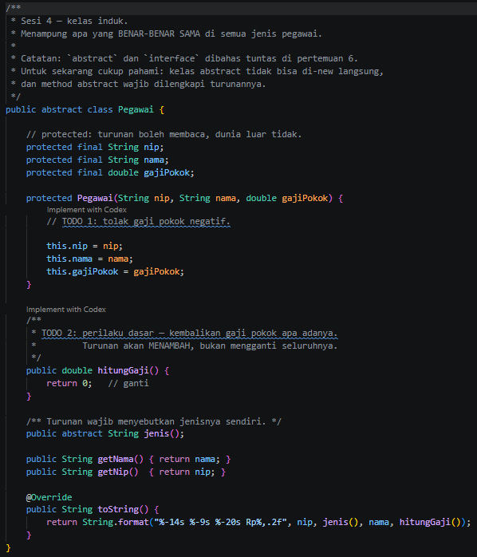

- *After* (Kondisi akhir / Eksekusi berhasil):
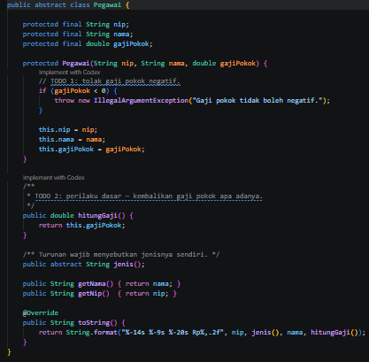

### 1.2. File: PegawaiTetap.java
*Penjelasan Kode:*
> Kelas `PegawaiTetap` mewarisi kelas `Pegawai` dengan menambahkan perhitungan tunjangan masa kerja yang dihitung berdasarkan persentase per tahun dengan batasan maksimum tertentu (`Math.min`), menggunakan pemanggilan `super(...)` untuk konstruktor kelas induknya.

*Bukti Eksekusi (Screenshot):*
- *After* (Kondisi akhir / Eksekusi berhasil):
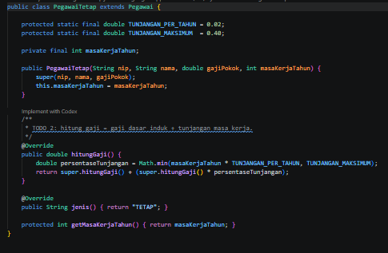

### 1.3. File: PegawaiKontrak.java
*Penjelasan Kode:*
> Kelas `PegawaiKontrak` merupakan turunan langsung dari `Pegawai` yang merepresentasikan pegawai dengan masa kontrak tertentu tanpa tunjangan masa kerja khusus, sehingga method `hitungGaji()` mengembalikan gaji dasar secara langsung.

*Bukti Eksekusi (Screenshot):*
- *Before* (Kondisi awal / Kesalahan kompilasi):
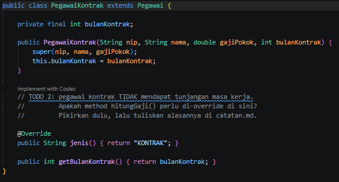

- *After* (Kondisi akhir / Eksekusi berhasil):
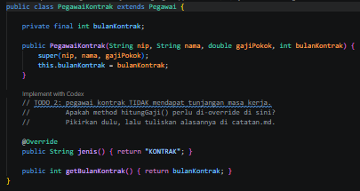

### 1.4. File: Dosen.java
*Penjelasan Kode:*
> Kelas `Dosen` dibuat sebagai kelas turunan baru yang mewarisi `PegawaiTetap`. Kelas ini menambahkan atribut akademik seperti jumlah SKS dan honor per SKS (atau tunjangan fungsional), lalu melakukan *override* pada `hitungGaji()` untuk mengakumulasikan honor tambahan ke dalam total gaji.

*Bukti Eksekusi (Screenshot):*
- *After* (Kondisi akhir / Eksekusi berhasil):
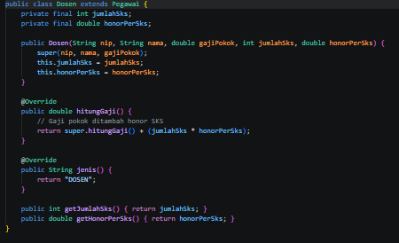

### 1.5. File: PegawaiHarian.java
*Penjelasan Kode:*
> Kelas `PegawaiHarian` adalah kelas turunan baru yang memperluas kelas `Pegawai` dengan memperhitungkan upah berdasarkan jumlah jam kerja atau hari masuk harian, lengkap dengan validasi untuk menolak nilai jam kerja negatif.

*Bukti Eksekusi (Screenshot):*
- *After* (Kondisi akhir / Eksekusi berhasil):
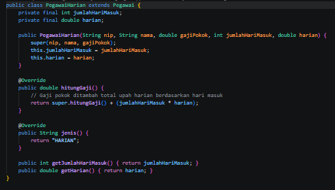

### 1.6. File: Main.java
*Penjelasan Kode:*
> Kelas `Main` berfungsi sebagai titik masuk utama (*entry point*) untuk menguji seluruh hierarki kelas pegawai dengan menerapkan prinsip **polimorfisme** melalui koleksi array bertipe `Pegawai`.

*Bukti Eksekusi (Screenshot):*
- *Before* (Kondisi awal / Kesalahan kompilasi):
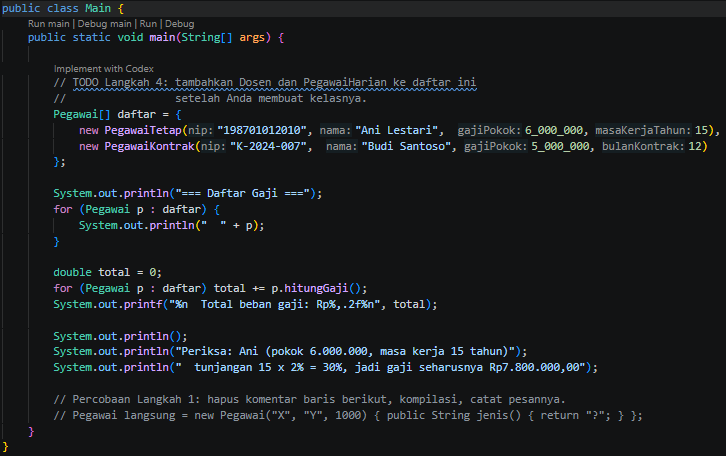

- *After* (Kondisi akhir / Eksekusi berhasil):
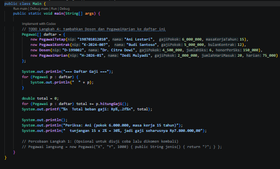

### Output
*Output Program Java:*

---

## 2. Implementasi PHP

### 2.1. File: Pegawai.php
*Penjelasan Kode:*
> Berkas `Pegawai.php` mendefinisikan struktur kelas abstrak induk serta kelas-kelas turunannya (`PegawaiTetap`, `PegawaiKontrak`, `Dosen`, dan `PegawaiHarian`) dalam standar PHP modern menggunakan *Constructor Property Promotion* dan kata kunci `readonly` untuk menjaga keamanan data.

*Bukti Eksekusi (Screenshot):*
- *Before* (Kondisi awal / Galat logika):
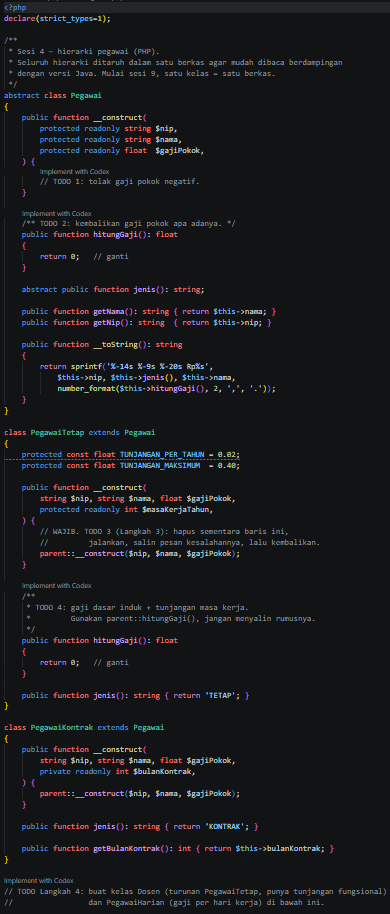

- *After* (Kondisi akhir / Eksekusi berhasil):
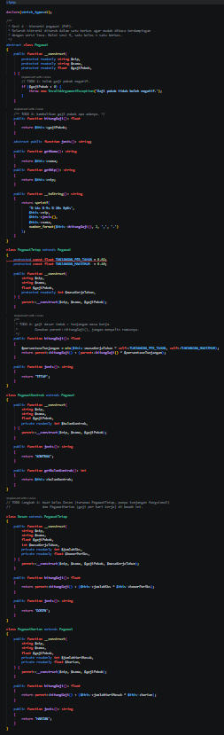

### 2.2. File: main.php
*Penjelasan Kode:*
> Berkas `main.php` bertindak sebagai *driver script* untuk menguji seluruh instansiasi objek turunan pegawai pada PHP, menerapkan pemanggilan `parent::__construct` serta polimorfisme saat menghitung total keseluruhan beban gaji perusahaan.

*Bukti Eksekusi (Screenshot):*
- *Before* (Kondisi awal / Galat logika):
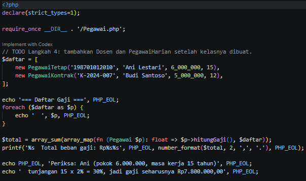

- *After* (Kondisi akhir / Eksekusi berhasil):
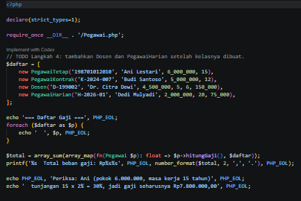

### Output
*Output Program PHP:*

---

## 3. Kesimpulan
> Praktikum Pertemuan 04 ini berhasil membuktikan bahwa penerapan konsep **Pewarisan (*Inheritance*)** dan **Polimorfisme** memungkinkan penggunaan kembali kode (*code reuse*) secara terstruktur dan fleksibel. Melalui pemanfaatan kelas abstrak, method *overriding*, serta pemanggilan konstruktor induk (`super`/`parent`), kita dapat memperluas fungsi sistem dengan mudah dengan menambahkan entitas baru seperti `Dosen` dan `PegawaiHarian` tanpa merusak logika dasar dari kelas induknya, baik pada bahasa **Java** maupun **PHP**.