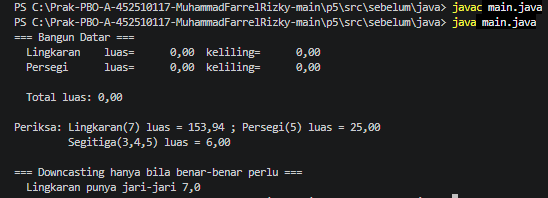
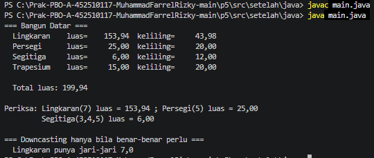
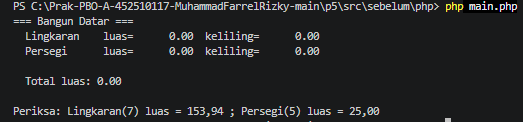
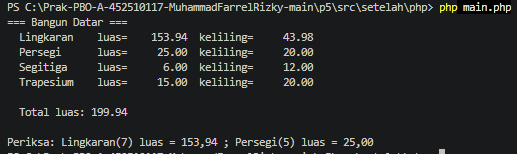

# Praktikum 05 — Polimorfisme

- **Nama:** Muhammad Farrel Rizky
- **NPM:** 4525210117
- **Kelas:** Prak. PBO A Room AI
- **Dosen Pengampu:** Adi Wahyu Pribadi, S.Si., M.Kom

---

## A. Ringkasan Tugas
Praktikum sesi ini berfokus pada penerapan konsep **Polimorfisme** dalam **Pemrograman Berorientasi Objek (PBO)** menggunakan bahasa **Java** dan **PHP (8.4+)**. Polimorfisme memungkinkan objek dari kelas turunan yang berbeda untuk merespons pemanggilan *method* yang sama melalui antarmuka atau kelas induk (*parent class*) dengan cara mereka masing-masing (*dynamic method dispatch*). Kita mempelajari bagaimana menghilangkan *anti-pattern* pemeriksaan tipe manual (`instanceof` atau `switch-case`) dan menggantinya dengan struktur polimorfik yang memenuhi prinsip *Open/Closed Principle* (OCP).

---

## B. Penjelasan Penambahan File & Pengerjaan TODO (Java)

Dalam pengerjaan modul Java, beberapa kelas dasar telah disediakan, namun kita perlu melengkapi kelas turunan yang ada serta membuat beberapa **file baru** agar program utama (`Main.java`) dapat berjalan sesuai aturan kontrak polimorfisme tanpa mengubah logika perulangannya.

Berikut adalah rincian file yang dikerjakan beserta alasan teknis penambahan file baru:

1. **Penyelesaian `Lingkaran.java` & `Persegi.java`**
   * **Yang Dikerjakan:** Menambahkan validasi invariant di *constructor* (menolak nilai $\le 0$ dengan melemparkan `IllegalArgumentException`) serta mengimplementasikan method abstrak `luas()` dan `keliling()` menggunakan formula matematika yang akurat (menggunakan `Math.PI` untuk lingkaran).
   * **Tujuan:** Memastikan setiap kelas turunan mematuhi kontrak yang ditetapkan oleh kelas abstrak induk (`BangunDatar`).

2. **Pembuatan File Baru: `Segitiga.java`**
   * **Alasan Pembuatan File Baru:** Diperlukan untuk memenuhi *TODO Langkah 2* di `Main.java` yang menguji penambahan jenis bangun datar baru ke dalam array `BangunDatar[]`.
   * **Implementasi:** Kelas ini memperluas `BangunDatar` dengan menerima parameter alas, tinggi, dan sisi miring, serta menghitung luas segitiga ($0.5 \times \text{alas} \times \text{tinggi}$) dan kelilingnya secara mandiri.

3. **Pembuatan File Baru: `Trapesium.java`**
   * **Alasan Pembuatan File Baru:** Diperlukan untuk memenuhi *TODO Langkah 4* di `Main.java` guna menguji perluasan hierarki kelas lebih lanjut.
   * **Implementasi:** Menerapkan perhitungan luas trapesium berdasarkan jumlah sisi sejajar dikali tinggi dibagi dua, serta menjumlahkan seluruh sisinya untuk mendapatkan keliling.

4. **Pembuatan File Baru: `AntiPatternRefaktor.java` (Langkah 5)**
   * **Alasan Pembuatan File Baru:** Untuk menjawab tantangan Langkah 5 guna membandingkan pendekatan buruk (*anti-pattern*) yang menggunakan `instanceof` dengan pendekatan polimorfik murni menggunakan antarmuka (`interface`) atau kelas abstrak.

---

## C. Analisis Perbandingan: Anti-Pattern vs Polimorfisme (Langkah 5)

Berdasarkan analisis terhadap berkas `AntiPattern.java` dan hasil refaktornya, berikut adalah jawaban atas pertanyaan pemandu praktikum:

1. **Berapa baris yang harus disunting untuk menambah satu bangun datar baru?**
   * *Versi Anti-Pattern (`AntiPattern.java`):* Kita harus memodifikasi method `hitungLuas(Object bangun)` dengan menambahkan cabang `else if (bangun instanceof BangunBaru)` dan membuat struktur rekaman (*record*) baru. Jika ada 5 fungsi serupa di seluruh basis kode, maka 5 tempat berbeda harus disunting.
   * *Versi Polimorfik (`AntiPatternRefaktor.java` / `Main.java`):* **0 baris kode yang ada yang disunting.** Kita hanya perlu membuat kelas baru yang mewarisi `BangunDatar` (atau mengimplementasikan *interface*), sehingga kode pemanggil (*main loop*) tetap bersih tanpa perubahan sama sekali (*Open/Closed Principle*).

2. **Apa yang terjadi jika seseorang lupa menambahkan satu cabang `else-if`?**
   * Program akan lolos saat kompilasi, namun ketika dijalankan (*runtime*), objek baru tersebut akan jatuh ke blok `throw new IllegalArgumentException(...)`, menyebabkan aplikasi *crash* atau kegagalan bisnis yang sulit dilacak.

3. **Di mana pengetahuan "cara menghitung luas" SEHARUSNYA berada?**
   * Pengetahuan tersebut seharusnya berada di dalam masing-masing kelas objek bangun datar itu sendiri (enkapsulasi perilaku), bukan terpusat dalam struktur percabangan kondisional di kelas penguji atau utilitas luar.

---

## D. Implementasi PHP & Latihan Mandiri Notifikasi (`notifikasi.php`)

Pada bagian PHP, selain melengkapi `BangunDatar.php` dan `main.php` dengan kelas `Segitiga` (menggunakan rumus Heron dan validasi pertidaksamaan sisi) serta `Trapesium`, kita juga mengerjakan latihan mandiri hierarki `Notifikasi` pada berkas `notifikasi.php`.

* **Penerapan Polimorfisme:** Dibuat kelas abstrak `Notifikasi` dengan method abstrak `kirim(string $pesan)` dan `saluran()`.
* **Kelas Turunan:** `Email`, `SMS`, dan `WhatsApp` mengimplementasikan method `kirim()` sesuai format kanal komunikasi masing-masing.
* **Fungsi `kirimSemua()`:** Melakukan iterasi ke dalam daftar objek `Notifikasi[]` dan memanggil method `$notif->kirim($pesan)` secara polimorfik **tanpa** satu pun pemeriksaan tipe (`instanceof` atau `match/switch`), membuktikan bahwa pengiriman pesan bersifat fleksibel dan aman.

---

## E. Hasil Pengujian Program (Running)

Berikut adalah bukti hasil eksekusi program uji setelah seluruh `TODO` diselesaikan:

### 1. Java
* **Sebelum Perbaikan:** 
  > 
* **Sesudah Perbaikan:**
  > 

### 2. PHP
* **Sebelum Perbaikan:** 
  > 
* **Sesudah Perbaikan:**
  > 

---

## F. Kesimpulan
Praktikum Sesi 05 ini membuktikan bahwa polimorfisme merupakan pilar vital dalam PBO untuk merancang sistem yang modular, mudah dipelihara, dan skalabel. Dengan memanfaatkan *dynamic method dispatch*, kelas induk dapat mendelegasikan eksekusi method spesifik ke kelas turunan secara otomatis. Penambahan kelas baru seperti `Segitiga` dan `Trapesium` dapat dilakukan dengan mulus tanpa merusak kode utama yang sudah ada (*plug-and-play architecture*).