# LAPORAN PRAKTIKUM PEMROGRAMAN BERBASIS OBJEK

| Informasi Praktikan | Keterangan |
| :--- | :--- |
| *Nama* | Muhammad Farrel Rizky |
| *NPM* | 4525210117 |
| *Kelas* | Prak. PBO A Room AI |
| *Mata Kuliah* | Pemrograman Berbasis Objek (PBO) |
| *Pertemuan* | Praktikum 05 — Polimorfisme |
| *Tanggal* | 01/10/2026 |

---

## 1. Implementasi Java

### 1.1. File: BangunDatar.java
*Penjelasan Kode:*
> Kelas abstrak `BangunDatar` berfungsi sebagai kelas induk universal yang mendefinisikan kontrak method abstrak `luas()` dan `keliling()`. Validasi invariant diterapkan di dalam *constructor* untuk memastikan parameter nilai dasar tidak bernilai negatif atau nol.

*Bukti Eksekusi (Screenshot):*
- *Before* (Kondisi awal / Kesalahan kompilasi):
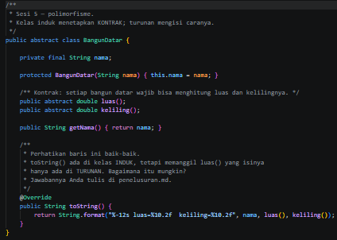

- *After* (Kondisi akhir / Eksekusi berhasil):
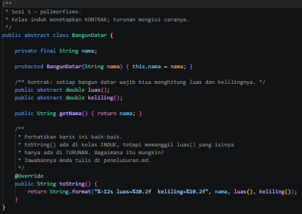

### 1.2. File: Lingkaran.java
*Penjelasan Kode:*
> Kelas `Lingkaran` mengimplementasikan kelas abstrak `BangunDatar` dengan menambahkan atribut radius serta menghitung luas ($\pi \times r^2$) dan keliling ($2 \times \pi \times r$) menggunakan konstanta `Math.PI`.

*Bukti Eksekusi (Screenshot):*
- *Before* (Kondisi awal / Kesalahan kompilasi):
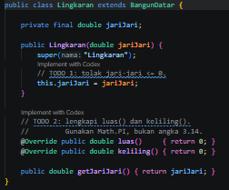

- *After* (Kondisi akhir / Eksekusi berhasil):
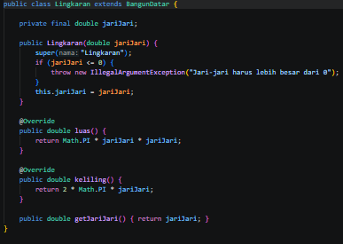

### 1.3. File: Persegi.java
*Penjelasan Kode:*
> Kelas `Persegi` memperluas `BangunDatar` untuk menghitung luas dan keliling bidang persegi berdasarkan panjang sisi yang tervalidasi.

*Bukti Eksekusi (Screenshot):*
- *Before* (Kondisi awal / Kesalahan kompilasi):
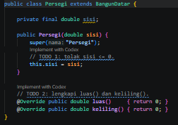

- *After* (Kondisi akhir / Eksekusi berhasil):
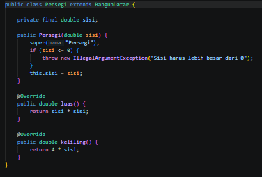

### 1.4. File: Segitiga.java
*Penjelasan Kode:*
> Kelas `Segitiga` merupakan file baru turunan `BangunDatar` yang dibuat untuk menguji fleksibilitas polimorfisme saat menambahkan bentuk geometri baru tanpa mengubah struktur kode utama.

*Bukti Eksekusi (Screenshot):*
- *After* (Kondisi akhir / Eksekusi berhasil):
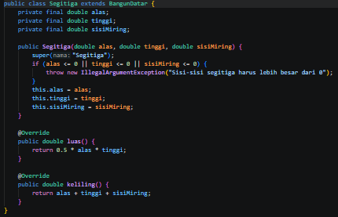

### 1.5. File: Trapesium.java
*Penjelasan Kode:*
> Kelas `Trapesium` adalah file turunan baru yang mengimplementasikan perhitungan geometri khusus trapesium (luas dan keliling) sebagai bentuk penerapan *Open/Closed Principle*.

*Bukti Eksekusi (Screenshot):*
- *After* (Kondisi akhir / Eksekusi berhasil):
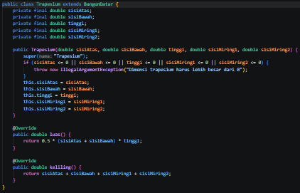

### 1.6. File: AntiPattern.java & AntiPatternRefaktor.java
*Penjelasan Kode:*
> Berkas `AntiPattern.java` mengilustrasikan kode buruk yang menggunakan pemeriksaan tipe manual (`instanceof`). Berkas ini kemudian direfaktor menjadi `AntiPatternRefaktor.java` untuk menerapkan polimorfisme murni berbasis *dynamic method dispatch*.

*Bukti Eksekusi (Screenshot):*
- *Before AntiPattern.java* (Kondisi awal):
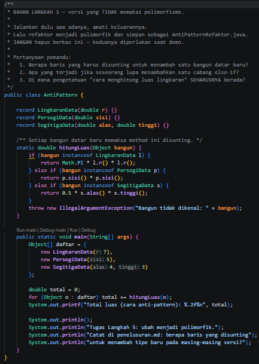

- *After AntiPattern.java* (Kondisi akhir):
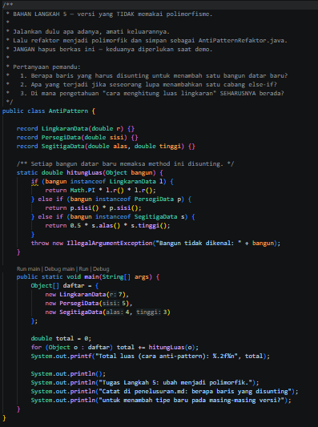

- *After AntiPatternRefaktor.java* (Kondisi akhir hasil refaktor):
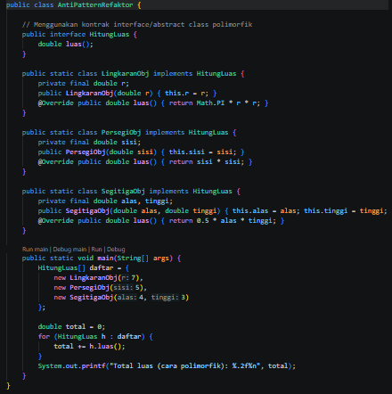

### 1.7. File: Main.java
*Penjelasan Kode:*
> Berkas `Main.java` bertindak sebagai titik masuk eksekusi (*entry point*) utama untuk menguji koleksi objek bangun datar secara polimorfik melalui perulangan array `BangunDatar[]`.

*Bukti Eksekusi (Screenshot):*
- *Before* (Kondisi awal / Kesalahan kompilasi):
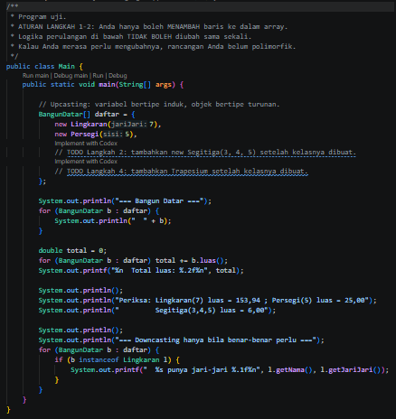

- *After* (Kondisi akhir / Eksekusi berhasil):
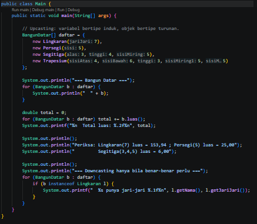

### Output
*Output Program Java:*
- *Before:* 
- *After:* 

---

## 2. Implementasi PHP

### 2.1. File: BangunDatar.php
*Penjelasan Kode:*
> Kelas abstrak `BangunDatar` pada PHP mendefinisikan kontrak hierarki geometri dengan menerapkan aturan pengetikan ketat (`declare(strict_types=1);`).

*Bukti Eksekusi (Screenshot):*
- *Before* (Kondisi awal / Galat logika):
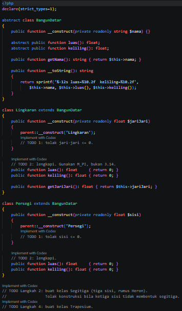

- *After* (Kondisi akhir / Eksekusi berhasil):
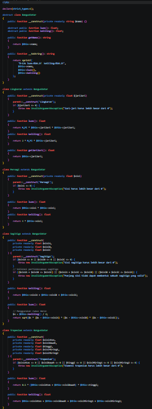

### 2.2. File: notifikasi.php
*Penjelasan Kode:*
> Berkas `notifikasi.php` mengimplementasikan latihan mandiri polimorfisme berupa sistem pengiriman pesan dengan berbagai saluran komunikasi (`Email`, `SMS`, dan `WhatsApp`) yang dipanggil secara seragam tanpa pemeriksaan tipe manual.

*Bukti Eksekusi (Screenshot):*
- *Before* (Kondisi awal / Galat logika):
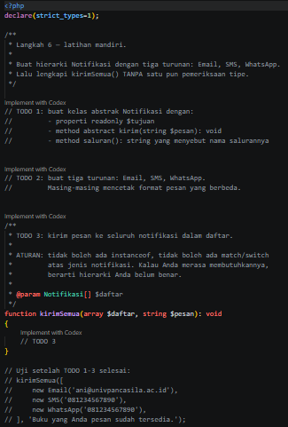

- *After* (Kondisi akhir / Eksekusi berhasil):

### 2.3. File: main.php
*Penjelasan Kode:*
> Berkas `main.php` berfungsi sebagai *driver script* utama untuk menjalankan pengujian polimorfisme pada PHP dan menampilkan hasilnya ke konsol.

*Bukti Eksekusi (Screenshot):*
- *Before* (Kondisi awal / Galat logika):
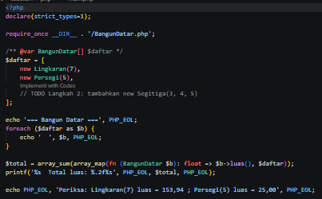

- *After* (Kondisi akhir / Eksekusi berhasil):
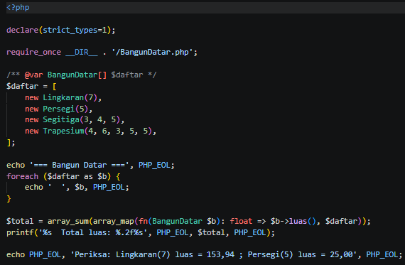

### Output
*Output Program PHP:*
- *Before:* 
- *After:* 

---

## 3. Analisis Perbandingan: Anti-Pattern vs Polimorfisme Murni
> Berdasarkan eksplorasi modul, pendekatan *anti-pattern* dengan `instanceof` memaksa pengembang mengubah banyak fungsi setiap ada penambahan entitas baru, yang rentan menimbulkan *bug*. Sebaliknya, penerapan **Polimorfisme** murni (*Open/Closed Principle*) memungkinkan penambahan kelas baru (seperti `Segitiga`, `Trapesium`, atau saluran `Notifikasi`) secara mulus tanpa menyunting kode pemanggil utama (*plug-and-play architecture*).

---

## 4. Kesimpulan
> Praktikum Sesi 05 ini berhasil membuktikan bahwa konsep **Polimorfisme** merupakan pilar esensial dalam Pemrograman Berorientasi Objek untuk menciptakan sistem yang modular, bersih, dan mudah diskalakan. Melalui mekanisme *dynamic method dispatch*, kelas induk dapat mendelegasikan pemanggilan method spesifik langsung ke kelas turunannya secara otomatis, baik pada bahasa **Java** maupun **PHP**.