# Laporan Praktikum PBO Pertemuan05
**Nama          :** Muhammad Farrel Rizky
**NPM           :** 4525210117
**Mata Kuliah   :** Praktikum Pemrograman Berorientasi Objek
## Materi
Menghitung bangun datar
Materi: Polimorfisme
## Screenshot Coding AntiPattern.java
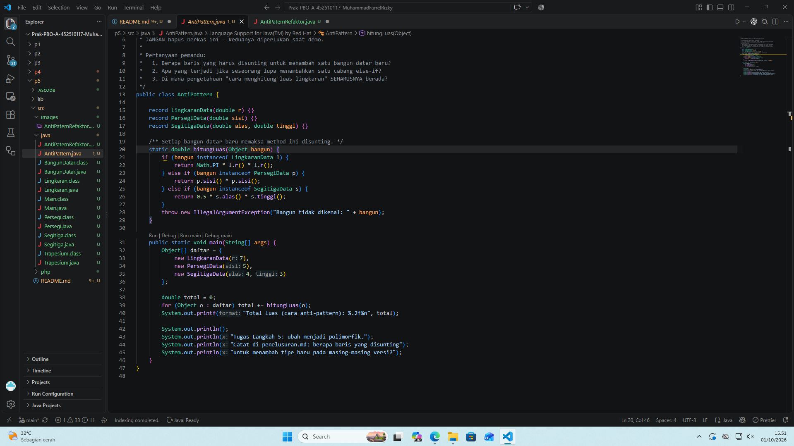
## Screenshot Coding AntiPatternRefaktor.java
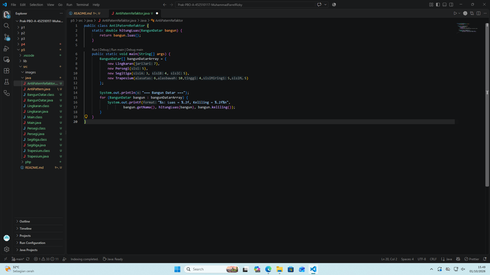
## Screenshot Coding BangunDatar.java
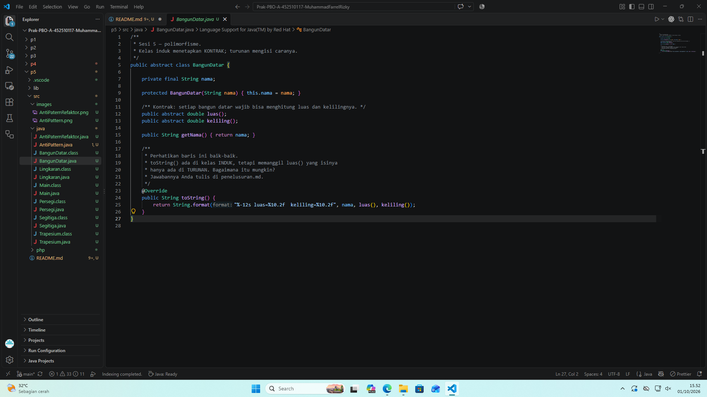
## Screenshot Coding Lingkaran.java
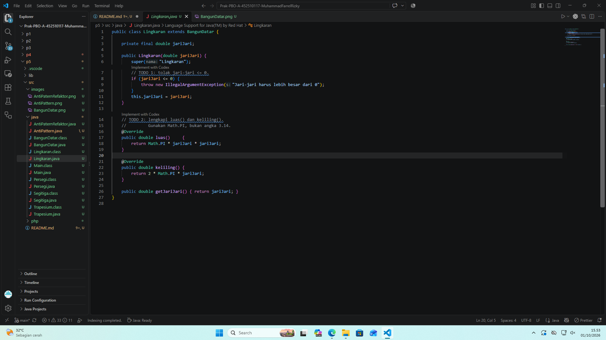
## Screenshot Coding Main.java
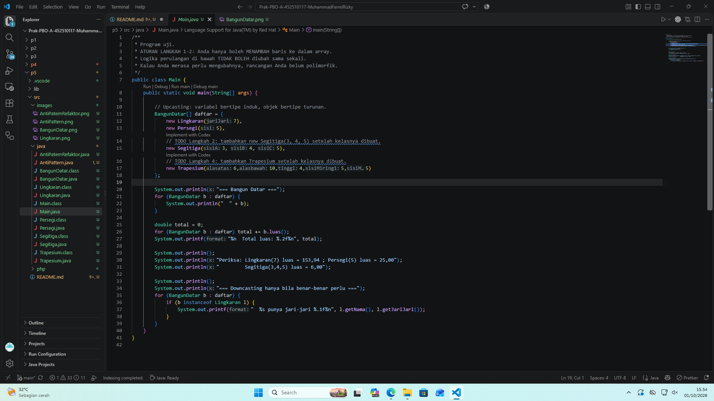
## Screenshot Coding Persegi.java
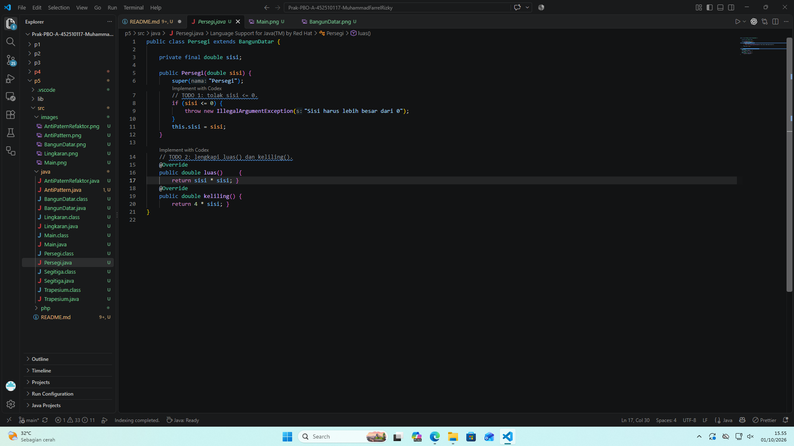
## Screenshot Coding Segitiga.java
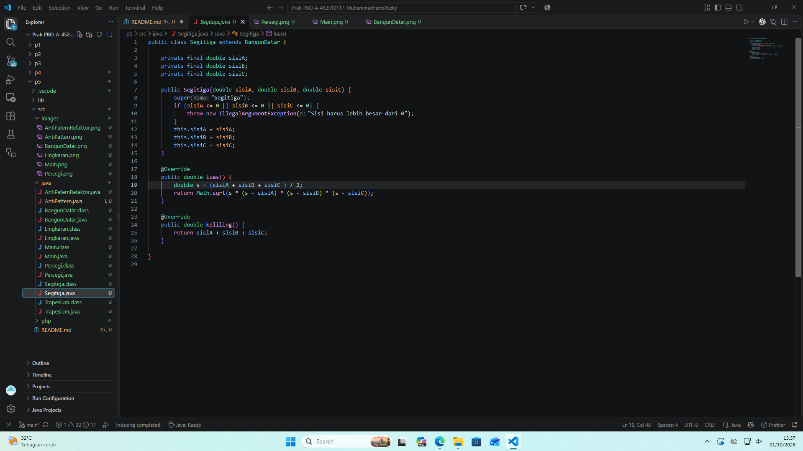
## Screenshot Coding Trapesium.java
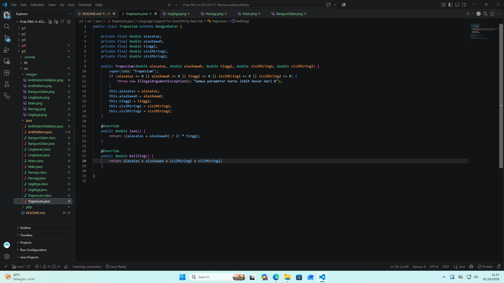
## Hasil Running Program java
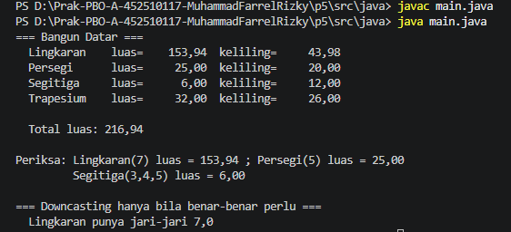
## Screenshot Coding Main.php
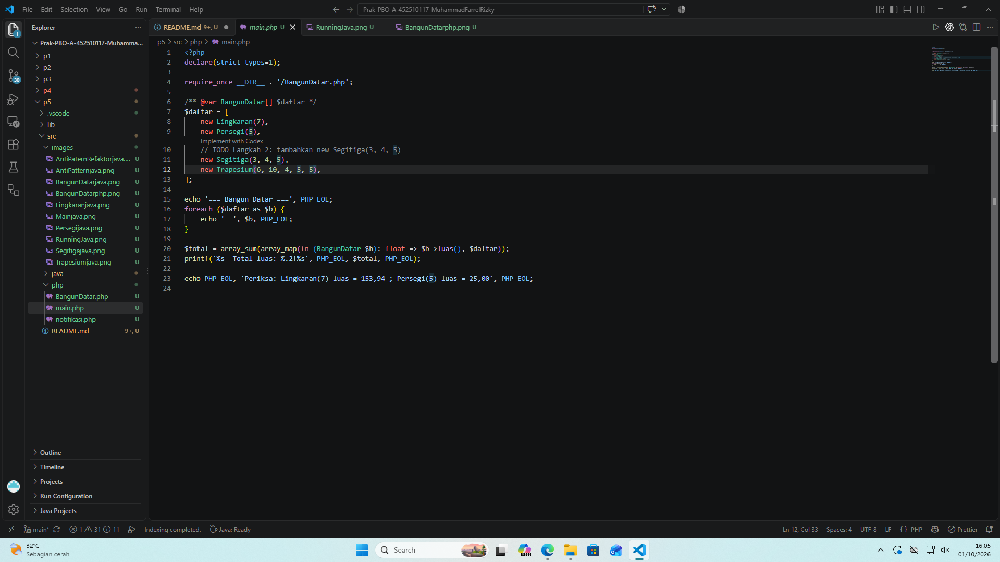
## Screenshot Coding BangunDatar.php

## Hasil Running notifikasi.php

## Hasil Running Program php
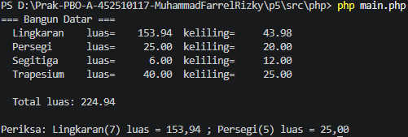