# Praktikum 06 — Abstract Class, Interface, Enum, dan Trait

- **Nama:** Muhammad Farrel Rizky
- **NPM:** 4525210117
- **Kelas:** Prak. PBO A Room AI
- **Dosen Pengampu:** Adi Wahyu Pribadi, S.Si., M.Kom

---

## A. Ringkasan Tugas
Praktikum sesi ini berfokus pada eksplorasi lanjutan konsep **Pemrograman Berorientasi Objek (PBO)** untuk mendesain arsitektur perangkat lunak yang fleksibel dan modular menggunakan:
1. **Abstract Class**: Berfungsi sebagai kerangka dasar (*base class*) yang menampung atribut bersama dan logika konkrit yang sama persis di semua kelas turunannya (seperti atribut `merek`, `tahun`, dan method perhitungan `umur`), sekaligus mendefinisikan *abstract method* (`jumlahRoda`) yang wajib diimplementasikan oleh subclass.
2. **Interface**: Kontrak perilaku (*behavioral contract*) yang mendefinisikan apa yang bisa dilakukan oleh sebuah objek tanpa mempermasalahkan wujud atau jenis bendanya. Kita memisahkan antara interface `Movable` (bisa bergerak) dan `Fuelable` (butuh bahan bakar) untuk menerapkan *Interface Segregation Principle* (tidak semua benda bergerak butuh bahan bakar, contohnya sepeda).
3. **Enum (Enumeration)**: Struktur data khusus untuk membatasi nilai yang valid sekaligus menyematkan perilaku bisnis di dalamnya (seperti method `biayaPengisian()` dan `ramahLingkungan()`), menggantikan konstanta angka/string mentah (*magic numbers*) yang rawan error.
4. **Trait** *(khusus PHP)*: Mekanisme penggunaan ulang kode secara horizontal (*horizontal code reuse*) yang memungkinkan kelas-kelas yang tidak memiliki hubungan kekerabatan (*inheritance*) untuk berbagi method yang sama (seperti fungsi pencatatan log pada `Mobil` dan `Pesanan`).

---

## B. Penjelasan Perubahan, Penambahan File, & Pengerjaan TODO

Berikut adalah rincian pengerjaan dan alasan teknis dari setiap komponen pada bahasa **Java** dan **PHP**:

### 1. Implementasi dalam Bahasa Java

#### a. `Kendaraan.java` (Abstract Class)
* **TODO 1:** Mengimplementasikan method `umur(int tahunSekarang)` untuk menghitung selisih tahun saat ini dengan tahun pembuatan kendaraan. Penggunaan `Math.max(0, tahunSekarang - tahun)` diterapkan untuk memastikan bahwa nilai umur yang dikembalikan tidak pernah bernilai negatif, menjaga integritas data waktu.
* **Alasan Desain:** Kelas ini bertindak sebagai fondasi bersama untuk menghindari duplikasi kode atribut `merek` dan `tahun` pada setiap jenis kendaraan.

#### b. `Movable.java` & `Fuelable.java` (Interface)
* **Movable (TODO 1):** Menambahkan *default method* `ringkasanGerak()` yang mengembalikan string deskripsi kecepatan maksimum dengan memanggil method `kecepatanMaksimum()`. Fitur *default method* (Java 8+) memungkinkan penambahan perilaku baru pada interface tanpa merusak implementasi kelas-kelas konkrit yang sudah ada di bawahnya.
* **Fuelable:** Interface bersih yang hanya berisi kontrak pengisian bahan bakar (`isiBahanBakar`, `kapasitasTangki`, `tipeBahanBakar`).

#### c. `TipeBahanBakar.java` (Enum)
* **TODO 1 s.d. 4:** Mendefinisikan konstanta enum (`BENSIN`, `SOLAR`, `LISTRIK`) lengkap dengan argumen konstruktor berupa label dan harga per satuan. Mengimplementasikan method `biayaPengisian(double jumlah)` untuk perkalian matematis biaya serta `ramahLingkungan()` yang mengembalikan nilai `true` eksklusif hanya untuk bahan bakar `LISTRIK` (`this == LISTRIK`).
* **Keunggulan:** Enum di Java jauh lebih superior dibandingkan konstanta integer biasa karena bertipe aman (*type-safe*) dan mampu merangkum logika serta perilaku (*behavior*) di dalam enum itu sendiri.

#### d. `Mobil.java` & Penambahan Berkas Baru `Sepeda.java`
* **Mobil:** Mengimplementasikan *multiple inheritance of type* (`extends Kendaraan implements Movable, Fuelable`). Melengkapi method `jumlahRoda()` (4 roda), `bergerak()`, `kecepatanMaksimum()` (180.0 km/jam), serta logika validasi pada `isiBahanBakar(double jumlah)` agar menolak nilai $\le 0$ dan mencegah isi tangki melebihi kapasitas maksimum tangki.
* **Penambahan Berkas Baru — `Sepeda.java`:** 
  * *Mengapa file baru ini harus dibuat?* Untuk membuktikan penerapan prinsip *Interface Segregation Principle*. `Sepeda` merupakan turunan `Kendaraan` yang hanya mengimplementasikan interface `Movable` (memiliki 2 roda dan bisa dikayuh), **tetapi tidak** mengimplementasikan `Fuelable` karena sepeda tidak membutuhkan bahan bakar bensin atau solar.
  * Kelas ini mengimplementasikan method `jumlahRoda()` (2 roda), `bergerak()`, dan kecepatan maksimum sepeda (35.0 km/jam).

#### e. `Main.java` & Penambahan Berkas Baru `keputusan.md`
* **Main.java:** Menguji polimorfisme melalui antarmuka `Movable` dengan melewatkan objek `Mobil` dan `Sepeda` ke dalam daftar iterasi. Menguji fungsi `isiPenuh(Fuelable kendaraan)` yang hanya bisa menerima objek yang mengimplementasikan `Fuelable`.
* **Penambahan Berkas Baru — `keputusan.md`:** 
  * *Mengapa file baru ini harus dibuat?* Untuk mencatat dokumentasi keputusan desain arsitektur program, termasuk menjawab pertanyaan mengapa Java melarang *multiple class inheritance* (untuk menghindari *Diamond Problem*) namun memperbolehkan *multiple interface implementation*.
  * Dokumen ini juga merekam pesan kesalahan kompilasi tatkala objek `Sepeda` dipaksa masuk ke fungsi `isiPenuh(sepeda)`:
    ```text
    error: incompatible types: Sepeda cannot be converted to Fuelable
        isiPenuh(sepeda);
                 ^
    ```
  * Penjelasan mengapa penolakan saat kompilasi (*compile-time safety*) ini sangat menguntungkan adalah karena compiler mendeteksi ketidakcocokan tipe data secara dini sebelum program dijalankan, sehingga mencegah potensi *bug* atau *runtime crash* pada aplikasi nyata.

---

### 2. Implementasi dalam Bahasa PHP (8.4+)

Penyesuaian pada versi PHP menerapkan fitur modern seperti *Backed Enum*, *Constructor Property Promotion*, *Readonly properties*, *Match expressions*, dan *Traits*:
* **Interface & Abstract Class (`abstraksi.php`):** Mendefinisikan kontrak `Movable` dan `Fuelable` dengan tipe data ketat (`declare(strict_types=1);`), serta kelas abstrak `Kendaraan` dengan perhitungan umur berbasis `max(0, ...)`.
* **Enum (`TipeBahanBakar`):** Menggunakan *Backed Enum* berbasis string (`case Bensin = 'bensin';`, `case Solar = 'solar';`, `case Listrik = 'listrik';`) yang dilengkapi fungsi `label()`, `hargaPerSatuan()`, `biayaPengisian()`, dan `ramahLingkungan()` menggunakan ekspresi `match`.
* **Trait (`Loggable`):** Menyediakan mekanisme penggunaan ulang kode secara horizontal. Method `log(string $pesan)` mencetak log terformat beserta waktu sistem dan nama kelas pemanggil secara dinamis (`(new ReflectionClass(static::class))->getShortName()`).
* **Penambahan Kelas `Sepeda` & `Pesanan`:** 
  * Kelas `Sepeda` dibuat mewarisi `Kendaraan` dan mengimplementasikan `Movable` (tanpa `Fuelable`).
  * Kelas `Pesanan` dibuat secara terpisah (bukan kerabat dari `Kendaraan`) namun tetap dapat menyisipkan `use Loggable;`, membuktikan fleksibilitas *trait* untuk berbagi fungsi lintas hierarki kelas yang berbeda.

---

## C. Hasil Pengujian Program (Running)

Berikut adalah bukti hasil eksekusi program uji setelah seluruh `TODO` diselesaikan:

### 1. Java
* **Sebelum Perbaikan:** 
  > 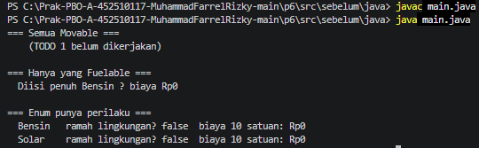
* **Sesudah Perbaikan:**
  > 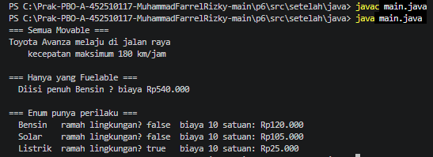

### 2. PHP
* **Sebelum Perbaikan:** 
  > 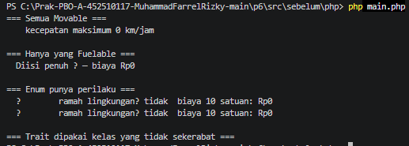
* **Sesudah Perbaikan:**
  > 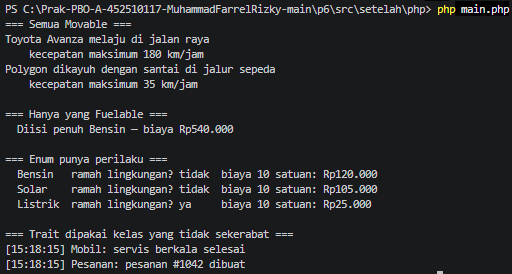

---

## D. Kesimpulan
Melalui Praktikum Sesi 06 ini, pemahaman mendalam mengenai kombinasi *Abstract Class*, *Interface*, *Enum*, dan *Trait* berhasil diterapkan baik pada ekosistem Java maupun PHP. Pemisahan kontrak yang tepat menggunakan interface mencegah ketergantungan antar-objek yang tidak relevan (seperti sepeda yang tidak perlu dipaksa memiliki fitur bahan bakar), sementara penggunaan enum dan trait meningkatkan kebersihan, keamanan tipe, serta kemudahan pemeliharaan kode sumber secara profesional.
=======
# Laporan Praktikum PBO Pertemuan 06

**Nama**        : Muhammad Farrel Rizky  
**NPM**         : 452510117  
**Mata Kuliah** : Praktikum Pemrograman Berorientasi Objek Room AI

---

## Materi
- **Abstraksi & Antarmuka (Abstract Class & Interface)**
- **Interface Segregation Principle (ISP)**
- **Enum dengan Perilaku/Method**
- **Trait (PHP) & Default Method (Java)**

---

## 1. Implementasi Bahasa Java

### Screenshot Coding Fuelable.java
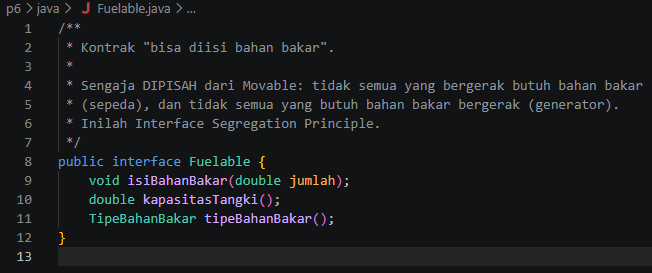
> **Penjelasan:** Interface `Fuelable` bertindak sebagai kontrak khusus bagi entitas yang menggunakan bahan bakar melalui method `isiBahanBakar()`, `kapasitasTangki()`, dan `tipeBahanBakar()`. Pemisahan antarmuka ini menerapkan *Interface Segregation Principle* (ISP) agar kelas yang tidak butuh bahan bakar (seperti `Sepeda`) tidak dipaksa mengimplementasikannya.

---

### Screenshot Coding Kendaraan.java
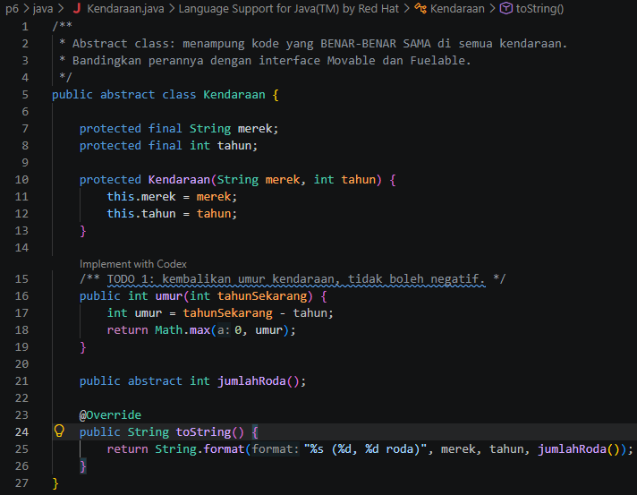
> **Penjelasan:** `Kendaraan` dirancang sebagai *abstract class* yang menjadi pondasi utama seluruh jenis kendaraan. Kelas ini menampung properti universal seperti `merk` dan `tahun`, melengkapi logika method konkrit `umur()`, serta mewajibkan implementasi *abstract method* `jumlahRoda()` pada kelas turunannya.

---

### Screenshot Coding Movable.java
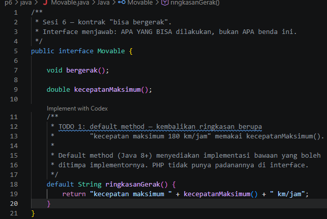
> **Penjelasan:** Antarmuka `Movable` mengatur fungsionalitas pergerakan objek lewat method `bergerak()` dan `kecepatanMaksimum()`. Fitur *default method* `ringkasanGerak()` dimanfaatkan untuk menyediakan format ringkasan kecepatan secara langsung tanpa memaksa sub-class menulis ulang kodenya.

---

### Screenshot Coding Mobil.java
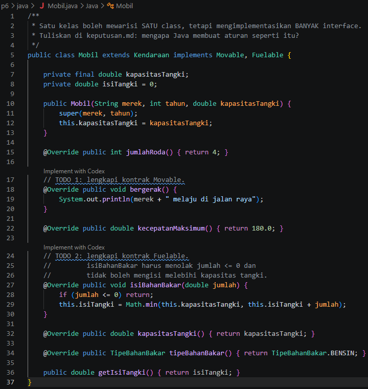
> **Penjelasan:** Kelas `Mobil` merupakan kelas konkrit turunan `Kendaraan` yang mengimplementasikan dua interface sekaligus (`Movable` dan `Fuelable`). Di dalamnya diatur kapasitas tangki, kecepatan maksimum, serta logika pengisian bahan bakar yang aman (menolak nilai `<= 0` dan tidak melebihi daya tampung tangki).

---

### Screenshot Coding Sepeda.java
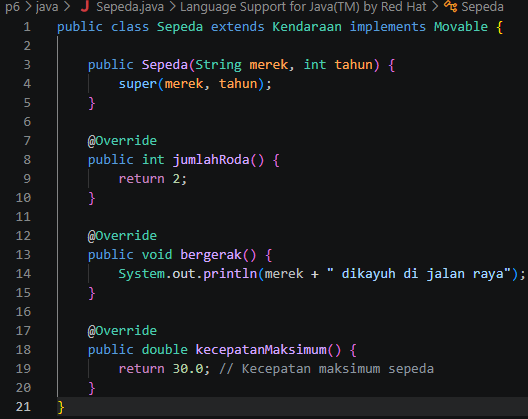
> **Penjelasan:** Kelas `Sepeda` mewarisi `Kendaraan` dan mengimplementasikan `Movable`, namun **TIDAK** mengimplementasikan `Fuelable`. Hal ini membuktikan fleksibilitas abstraksi interface, di mana sepeda dapat bergerak sebagai kendaraan tanpa harus memikul aturan pengisian bahan bakar.

---

### Screenshot Coding TipeBahanBakar.java
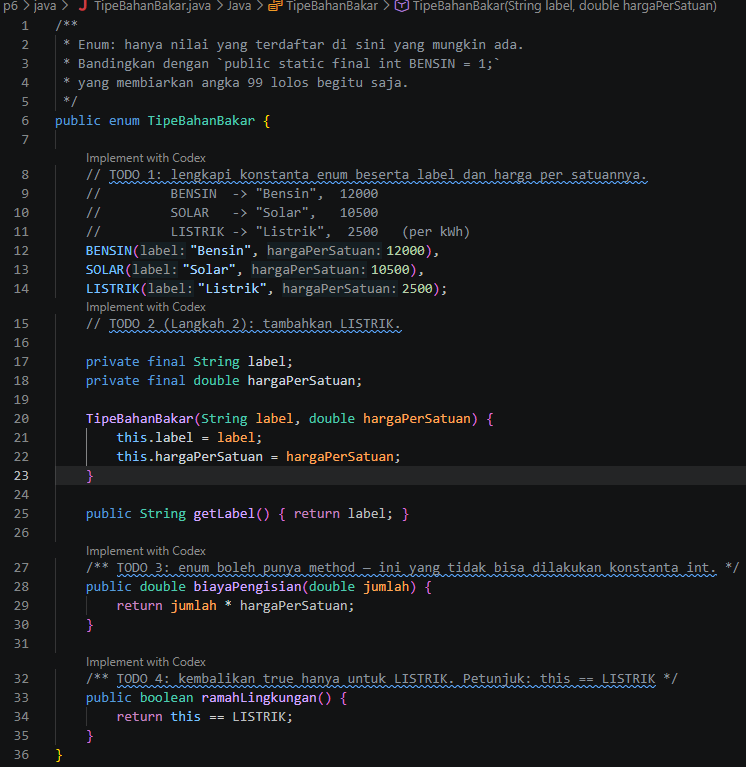
> **Penjelasan:** `TipeBahanBakar` mengimplementasikan tipe data *enum* yang tidak hanya menyimpan konstanta (`BENSIN`, `SOLAR`, `LISTRIK`), tetapi juga memiliki atribut (`label`, `hargaPerSatuan`) serta method perilaku seperti `biayaPengisian()` dan penanda `ramahLingkungan()`.

---

### Screenshot Coding Main.java
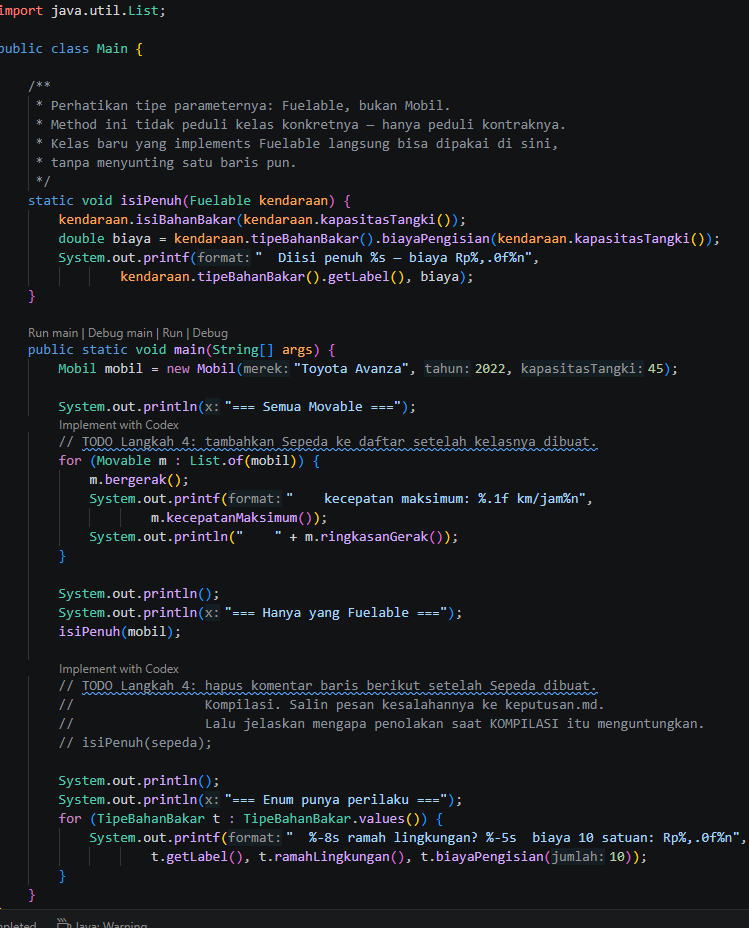
> **Penjelasan:** File `Main.java` berfungsi sebagai *entry point* untuk menguji seluruh kelas. Di dalamnya terdapat method `isiPenuh(Fuelable kendaraan)` yang memanfaatkan polimorfisme interface, sehingga mampu memproses objek apa pun selama mengimplementasikan `Fuelable`.

---

### Hasil Running Program Java
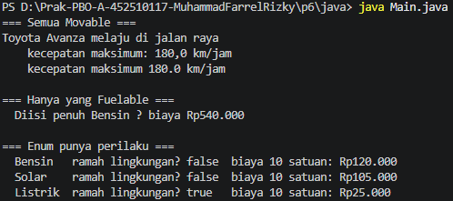
> **Penjelasan Output:** Program berhasil mengeksekusi metode pergerakan kendaraan, menampilkan ringkasan gerak, menghitung biaya pengisian bahan bakar mobil, serta menampilkan daftar enum tipe bahan bakar beserta kalkulasi biaya dan status ramah lingkungannya.

---

## 2. Implementasi Bahasa PHP

### Screenshot Coding abstraksi.php
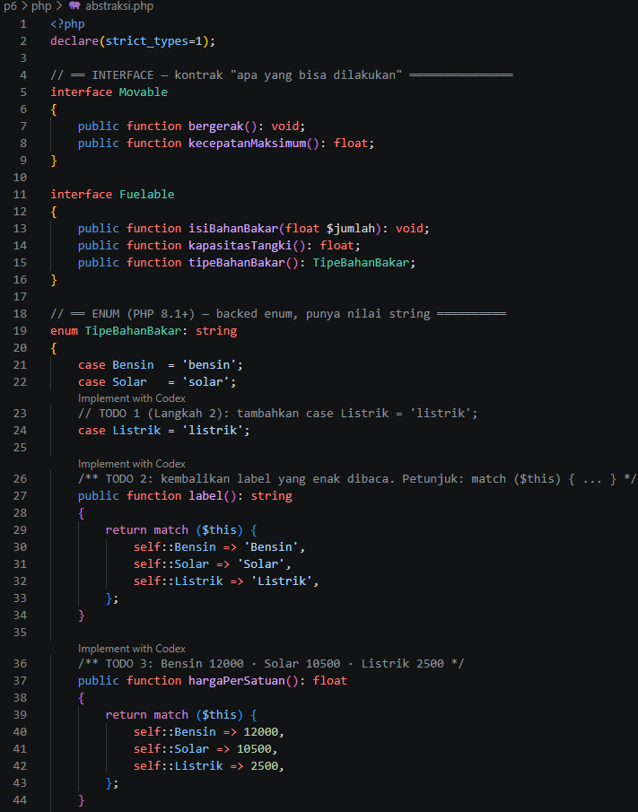
> **Penjelasan:** File ini berisi arsitektur OOP PHP yang meliputi interface `Movable` & `Fuelable`, `TipeBahanBakar` (Backed Enum PHP 8.1+), *Trait* `Loggable`, *Abstract Class* `Kendaraan`, serta kelas konkrit `Mobil`, `Sepeda`, dan `Pesanan`.
> 
> *Penggunaan Trait `Loggable`* menunjukkan konsep *horizontal code reuse*, di mana kelas `Mobil` dan kelas `Pesanan` (yang tidak sekerabat) dapat membagikan fungsi pencatatan log berstempel waktu yang sama.

---

### Screenshot Coding Main.php
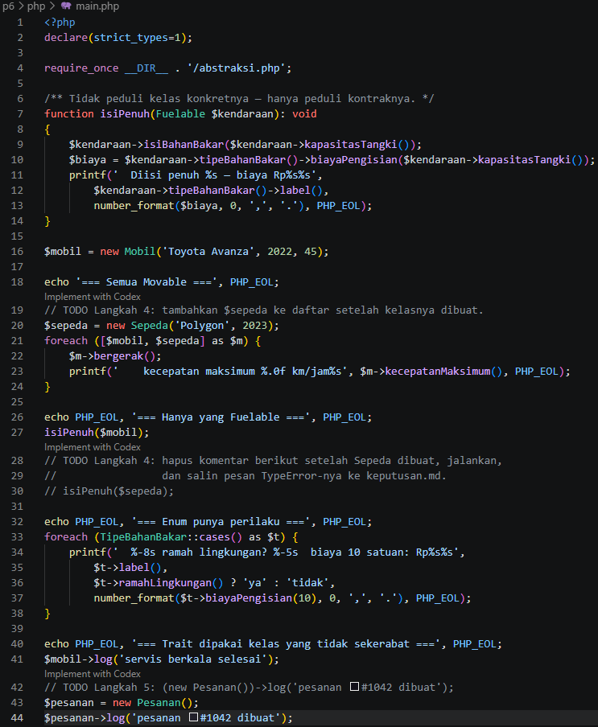
> **Penjelasan:** File eksekusi utama PHP yang mengimpor `abstraksi.php` menggunakan `require_once`. File ini menjalankan iterasi perulangan objek `Movable`, pemanggilan fungsi `isiPenuh()`, evaluasi Enum `TipeBahanBakar`, serta pengujian fitur trait `log()` pada entitas terpisah.

---

### Hasil Running Program PHP
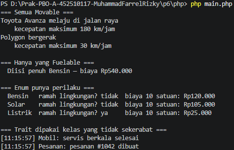
> **Penjelasan Output:** Menampilkan eksekusi program PHP yang berjalan lancar, memproses pengisian bahan bakar, pergerakan sepeda dan mobil, hingga pencetakan log berformat dari trait `Loggable`.

### Keputusan.md
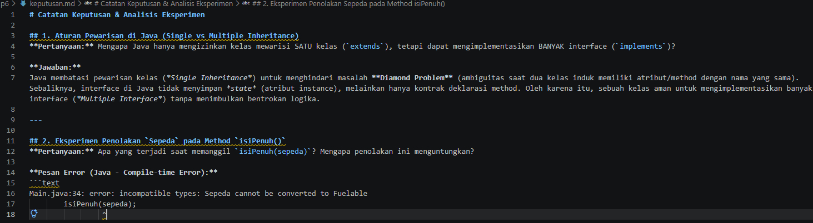
> *Penjelasan Analisis:*
> 1. *Penolakan saat Kompilasi/Run-time:* Penolakan Sepeda pada method isiPenuh(Fuelable) menguntungkan karena mencegah terjadinya bug logika pengisian bahan bakar pada kendaraan yang tidak memerlukannya sebelum program dieksekusi.
> 2. *Keuntungan Fitur Trait:* Trait Loggable memungkinkan fungsionalitas pencatatan log dipakai oleh Mobil dan Pesanan tanpa merusak atau mengacaukan struktur hirarki pewarisan utama dari Kendaraan.
