# LAPORAN PRAKTIKUM PEMROGRAMAN BERBASIS OBJEK

| Informasi Praktikan | Keterangan |
| :--- | :--- |
| *Nama* | Muhammad Farrel Rizky |
| *NPM* | 4525210117 |
| *Kelas* | A |
| *Mata Kuliah* | Pemrograman Berbasis Objek (PBO) |
| *Pertemuan* | Pertemuan 7 - Relasi Objek dan UML Class Diagram |
| *Tanggal* | 15/10/2026 |

---

## 1. Implementasi Java

### 1.1. File: Buku.java
*Penjelasan Kode:*
> Kelas `Buku` merepresentasikan relasi **Komposisi** terhadap kelas internal `Bab`. Komposisi terwujud melalui tiga aturan utama: objek bagian (`Bab`) dibuat di dalam kelas `Buku` melalui method `tambahBab` (bukan menerima objek dari luar), constructor `Bab` bersifat privat agar hanya bisa diinisiasi oleh induknya, serta method `get()` menggunakan `List.copyOf(bab)` untuk mencegah *collection leakage* dari luar. Selain itu, terdapat validasi untuk memastikan jumlah eksemplar tidak bernilai negatif.

*Bukti Eksekusi (Screenshot):*
- *Before* (Kondisi awal / Kesalahan kompilasi):
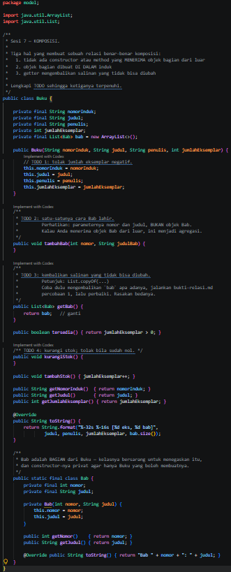

- *After* (Kondisi akhir / Eksekusi berhasil):
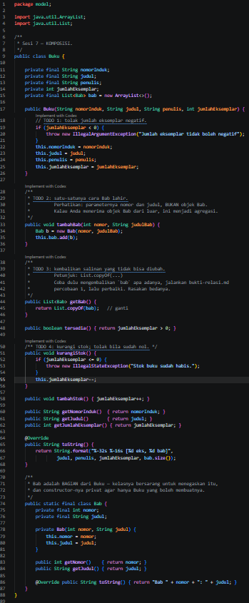

### 1.2. File: Jurusan.java
*Penjelasan Kode:*
> Kelas `Jurusan` merepresentasikan relasi **Agregasi** terhadap kelas `Mahasiswa`. Berbeda dengan komposisi, objek `Mahasiswa` diterima dari luar melalui method `daftarkan(Mahasiswa m)` dan tetap dapat hidup mandiri meskipun objek `Jurusan` dilepas atau dihapus. Validasi diterapkan untuk menolak nilai `null` serta mencegah duplikasi data mahasiswa yang sudah terdaftar.

*Bukti Eksekusi (Screenshot):*
- *Before* (Kondisi awal / Kesalahan kompilasi):
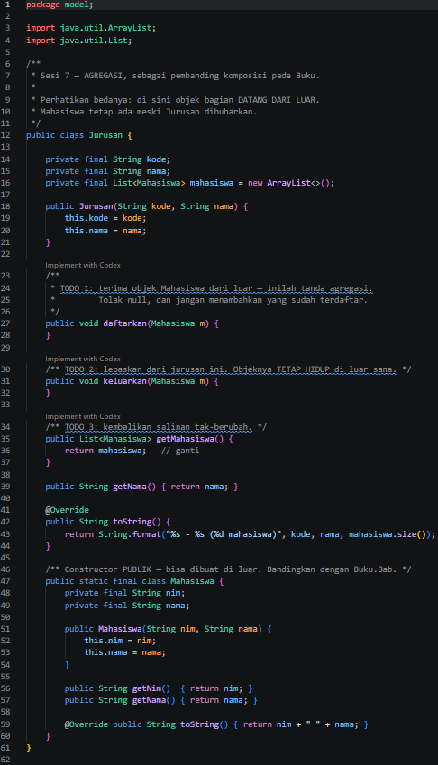

- *After* (Kondisi akhir / Eksekusi berhasil):
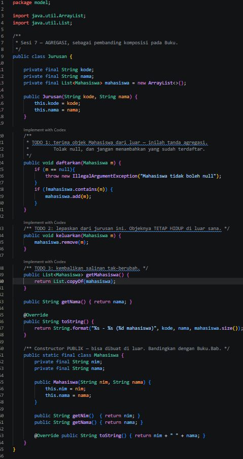

### 1.3. File: PerpustakaanService.java
*Penjelasan Kode:*
> Kelas `PerpustakaanService` berfungsi sebagai lapisan layanan (*service layer*) yang mengelola operasional sistem perpustakaan, seperti menyimpan koleksi buku, mencari buku berdasarkan nomor induk, serta memproses alur peminjaman dan pengembalian buku dengan memperbarui ketersediaan stok eksemplar.

*Bukti Eksekusi (Screenshot):*
- *Before* (Kondisi awal / Kesalahan kompilasi):
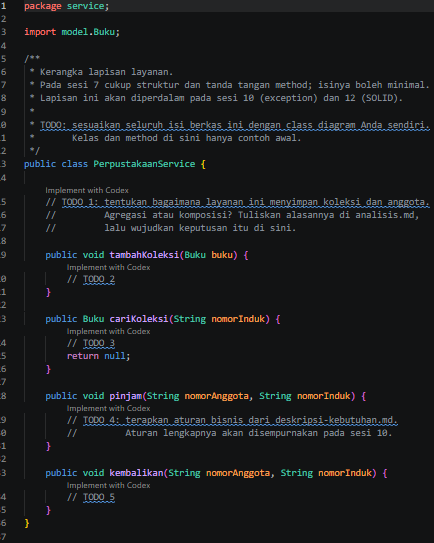

- *After* (Kondisi akhir / Eksekusi berhasil):

---

## 2. Implementasi PHP

### 2.1. File: relasi.php (Bab & Buku)
*Penjelasan Kode:*
> Kelas `Buku` dan `Bab` pada PHP menerapkan konsep komposisi serupa dengan Java. Karena PHP tidak mendukung *nested class*, disiplin komposisi dijaga melalui konvensi perancangan, constructor `readonly` pada `Bab`, serta enkapsulasi larik objek di dalam kelas `Buku`. Validasi parameter juga disematkan untuk mencegah nilai eksemplar negatif.

*Bukti Eksekusi (Screenshot):*
- *Before* (Kondisi awal / Galat logika):
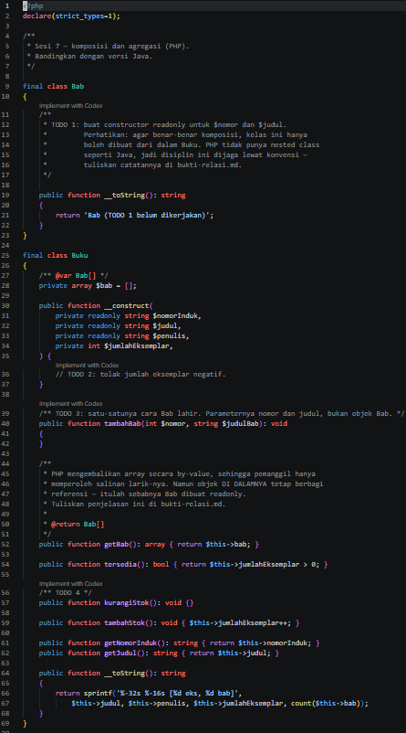

- *After* (Kondisi akhir / Eksekusi berhasil):
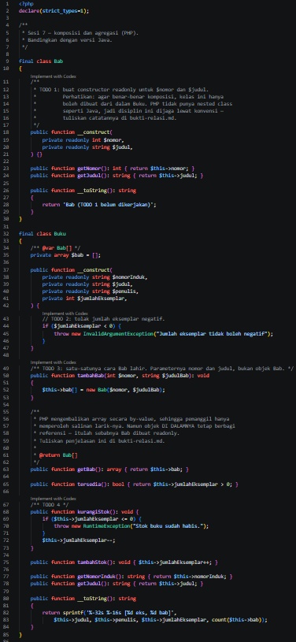

### 2.2. File: relasi.php (Jurusan & Mahasiswa)
*Penjelasan Kode:*
> Kelas `Jurusan` dan `Mahasiswa` pada PHP mengimplementasikan relasi **Agregasi**. Objek `Mahasiswa` diinjeksikan dari luar ke dalam larik koleksi jurusan melalui method `daftarkan()` dan dapat dikeluarkan melalui `keluarkan()` tanpa menghancurkan eksistensi objek mahasiswa di luar lingkup jurusan tersebut.

*Bukti Eksekusi (Screenshot):*
- *Before* (Kondisi awal / Galat logika):
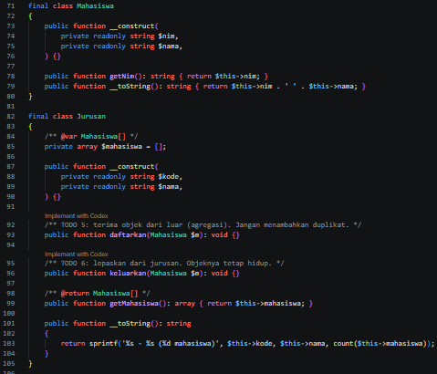

- *After* (Kondisi akhir / Eksekusi berhasil):
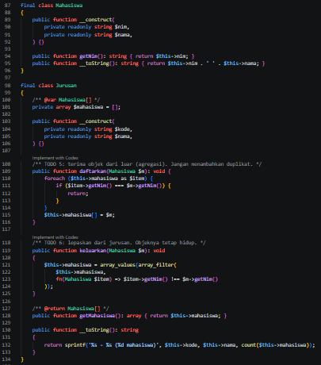

### 2.3. File: main.php
*Penjelasan Kode:*
> Berkas `main.php` berfungsi sebagai titik masuk eksekusi utama (*entry point*) untuk menguji hasil implementasi kelas-kelas berbasis PHP, memastikan relasi komposisi dan agregasi berjalan sesuai dengan rancangan spesifikasi sistem.

*Bukti Eksekusi (Screenshot):*
- *Before* (Kondisi awal / Galat logika):
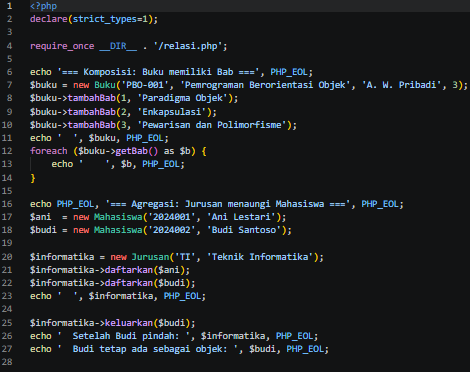

- *After* (Kondisi akhir / Eksekusi berhasil):
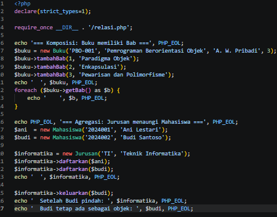

### Output
*Output Program PHP:*
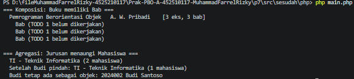

---

### 2.4. File: perpustakaan-kerangka.puml (Class Diagram Sistem Perpustakaan)
*Penjelasan Kode:*
> Berkas `perpustakaan-kerangka.puml` adalah kerangka dasar perancangan class diagram Sistem Perpustakaan yang dikembangkan secara bertahap. Berkas ini mendefinisikan struktur paket `model` (mencakup kelas abstrak `Koleksi`, `Buku`, `Bab`, `Anggota`, `Peminjaman`, serta enumerasi status dan jenis keanggotaan) dan paket `service` (`PerpustakaanService`), yang kemudian dilengkapi dengan notasi derajat keterikatan (*multiplicity* serta relasi komposisi dan agregasi).

*Bukti Eksekusi (Screenshot):*
- *Before* (Kondisi awal / Berkas kerangka asli dengan bagian TODO):
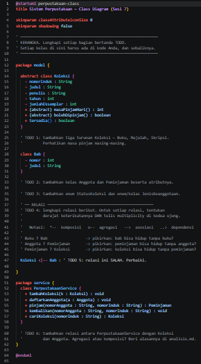

- *After* (Kondisi akhir / Berkas kerangka yang telah dilengkapi seluruh kelas dan relasinya):
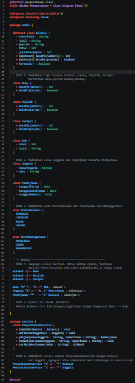

### Output
*Output Render Diagram Kerangka Class:*
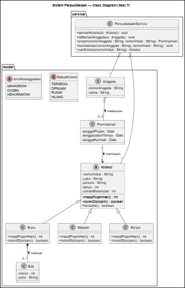

---

## 4. Kesimpulan
> Praktikum Pertemuan 7 ini berhasil membuktikan pemahaman mendalam mengenai pemodelan objek dan perbedaannya secara struktural di dalam kode pemrograman (Java dan PHP). Relasi **Komposisi** (seperti `Buku` dan `Bab`) menuntut objek bagian dibuat di dalam induk dan dilindungi dari modifikasi luar (*collection leakage*), di mana objek bagian akan musnah bersama induknya. Sebaliknya, relasi **Agregasi** (seperti `Jurusan` dan `Mahasiswa`) memperbolehkan objek bagian hidup secara mandiri meskipun dilepas dari objek induknya. Penerapan *multiplicity* dan diagram UML (`usecase`, `class`, dan `sequence`) juga memperjelas batasan serta aturan bisnis dari Sistem Perpustakaan.